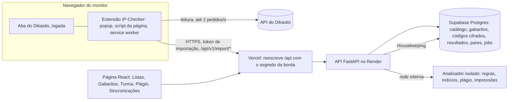
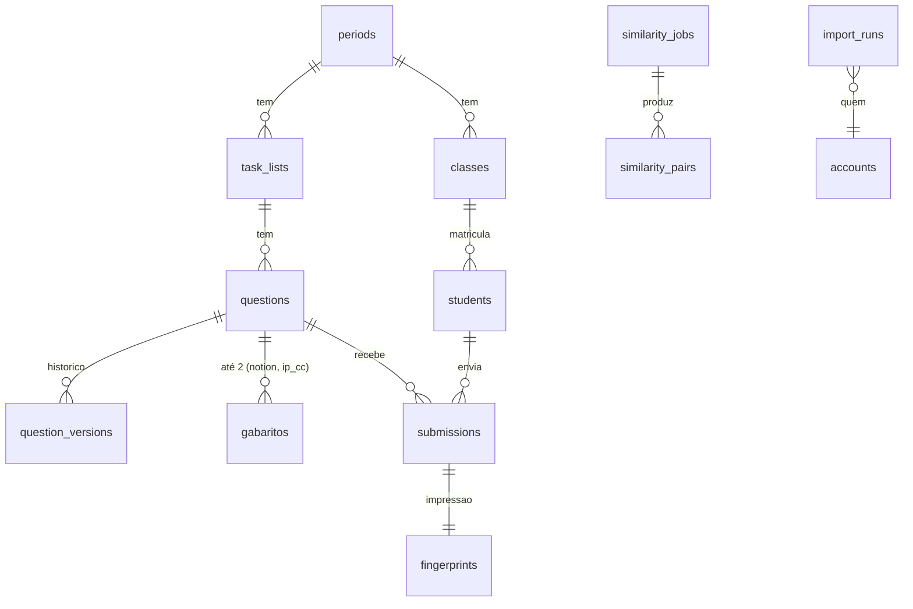
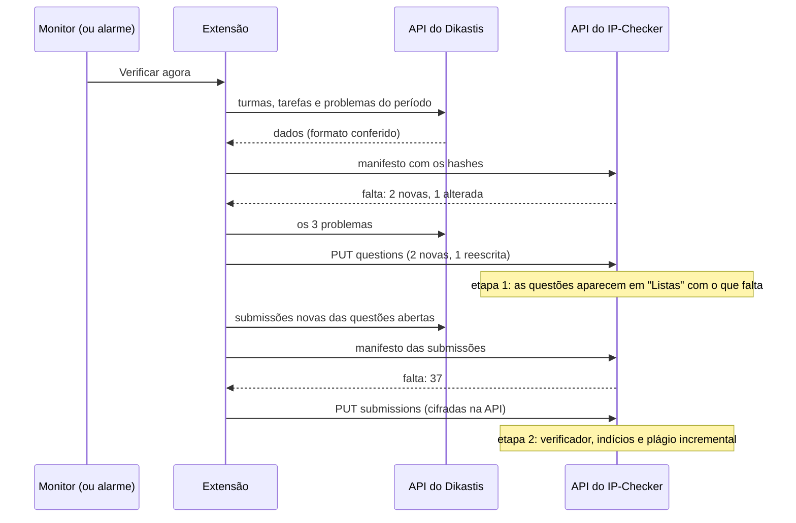

# Plano de 16/10/2026: CI incremental e integração com o Dikastis

**Data:** 16/10/2026. **Base:** `develop` = `main` = `970bec6` (release `sprint-42`, parte 1). **Situação:** aprovado pelo autor em 16/10/2026 nas duas partes da extensão (enunciados e códigos dos alunos), com a autorização dos professores e dos monitores-chefes; as decisões estão em [`decisoes.md`](decisoes.md) (Q-37 a Q-42). Nenhuma sprint começa sem o comando do autor. O estudo de caso que originou este plano está fora do repositório ([artefato](https://claude.ai/artifact/LQqeAGuk3iuaxHUFbVHsYa)).

As tasks de cada sprint, com missão, personas, execução, testes e deploy, estão em [`sprints/`](sprints/README.md) (Sprints 49 a 54); este arquivo traz a análise, a arquitetura, as decisões e a ordem.

---

## 1. Resumo executivo

Duas frentes, numa fase nova (Fase 1h, Sprints 49 a 54):

1. **A CI mais rápida (Sprint 49).** A rodada completa do `scripts/ci-local.sh --e2e` leva de 13 a 15 minutos e roda inteira a cada PR, mesmo quando só um arquivo `.md` mudou. Com os passos em paralelo, cada passo pulado quando as entradas dele não mudaram desde o último verde, e a auditoria só sobre o que mudou, um PR típico passa a levar cerca de 5 minutos, um PR só de documentação menos de 1, e a release completa cerca de 9 (seção 3). Todas as sprints seguintes pagam esse custo, por isso ela vem primeiro.
2. **A integração com o Dikastis (Sprints 50 a 54).** Uma extensão do navegador, instalada por quem já tem acesso ao Dikastis, lê a mesma API que a página do Dikastis usa e envia ao IP-Checker:
   - o **catálogo** das listas e questões de 2026.2 em diante, com os enunciados (Sprint 50), que destrava a parte 2 da Sprint 42;
   - os **gabaritos**, até dois por questão ("Notion" e "IP CC"), cadastrados por cliques pela chefia (Sprint 51);
   - o **último código de cada aluno** em cada questão, guardado cifrado por 6 períodos, com a análise em duas etapas (Sprint 52);
   - o **plágio por turma** (até 100) e **por período** (até 600), assíncrono e incremental (Sprint 53);
   - a **sincronização automática** e o painel de sincronizações (Sprint 54).

**Princípio de dependência mínima do Dikastis:** nenhuma mudança no código do Dikastis, nenhum pedido à equipe dele, nenhuma conta de serviço nem senha no servidor. A extensão só lê, com a sessão do próprio monitor, num ritmo baixo e só o que mudou. Tudo o que ela sabe da API do Dikastis fica num módulo único, que confere o formato de cada resposta e para com uma mensagem clara se ele mudar.

**Ordem:** **49 → 50 → 42.1 → 51 → 52 → 53 → 54**, depois 44, 45, 46 (o que sobrar), 47 e 48, com a 41 por último (P-24). Cerca de 77 SP; de 7 a 9 semanas de calendário no ritmo das sprints recentes.

---

## 2. O que foi conferido no Dikastis (16/10/2026)

Com a conta do autor logada no navegador, só lendo:

- A página é um aplicativo que busca tudo numa **API JSON no próprio domínio**. A sessão é um token do login guardado pelo próprio site, com validade.
- Os problemas seguem um nome fixo: `26.2L1Q1` é o período 2026.2, Lista 1, Questão 1. As turmas de um período ("IP SI UFPE 2026.2", "IP EC UFPE 2026.2", "IP CC/IA UFPE 2026.2") usam as mesmas listas. As 28 questões de 2026.2 com gabarito (Listas 1 a 4) existem com a mesma numeração; a Lista 5 já está publicada.
- Cada problema vem separado em título, descrição, descrição da entrada, descrição da saída, limite de tempo e casos de teste, cada caso marcado como **exemplo** ou **oculto**.
- Há um endereço que devolve as submissões de um aluno numa lista.
- A interface não tem exportação de enunciados nem de submissões; o "Relatório CSV" exporta só o placar.

| Endereço da API (leitura) | O que devolve | Usado em |
|---|---|---|
| `/api/problems?search=26.2L` | A lista dos problemas, com busca | Sprint 50 |
| `/api/problems/<id>` | Título, descrições, limite de tempo e os casos de teste (exemplo ou oculto) | Sprint 50 |
| `/api/tasks/<id>` | Uma lista (tarefa) e as questões dela; pede o token | Sprints 50 e 52 |
| `/api/tasks/<id>/overview` | O placar da lista, por aluno | Sprint 52 |
| `/api/organizations/<org>/<tarefa>/<login>/submissions` | As submissões de um aluno numa lista | Sprints 51 e 52 |

---

## 3. A CI mais rápida (Sprint 49)

### 3.1 Onde o tempo vai hoje

Rodada completa e limpa de 16/10/2026 (`970bec6`, máquina do autor, sem outra carga): **cerca de 14 minutos**, tudo em série.

| Passo | Tempo | Parte do total |
|---|---|---|
| Segurança (isolamento e imagem do piloto) | 200 s | 25% |
| Semgrep (varredura) | 127 s | 16% |
| e2e: Playwright + compose | 77 + 32 s | 14% |
| Benchmark do motor | 66 s | 8% |
| pytest em paralelo + em série | 51 + 52 s | 13% |
| Lighthouse | 52 s | 6% |
| pip-audit | 44 s | 5% |
| Vitest, npm ci, tipos do OpenAPI | 25 + 19 + 17 s | 8% |
| O resto (lint, tipos, build, gitleaks, gabaritos) | cerca de 35 s | 5% |

Três coisas explicam quase tudo: **(a)** tudo roda em série, embora as partes não dependam umas das outras; **(b)** os passos mais caros (segurança, Semgrep, benchmark, Lighthouse) rodam mesmo quando nada do que eles conferem mudou; **(c)** o Semgrep e o pip-audit refazem o mesmo trabalho a cada rodada (a varredura do repositório inteiro montado no Docker do Windows, que é lento para muitos arquivos; a consulta da mesma `uv.lock`).

### 3.2 O que muda

| Medida | Como | Ganho esperado |
|---|---|---|
| **Impressão digital das entradas** (ADR-20) | Cada passo declara os caminhos de que depende. O script calcula um hash do conteúdo desses caminhos (`git ls-files -s` mais o conteúdo dos modificados) e guarda, em `.git/ci-local-passos.json`, "passo → hash → verde em <sha>, <hora>". Um passo cujas entradas não mudaram desde um verde é pulado, com a linha "pulado: igual ao verde de `<sha>`" no resumo. `--completo` força tudo | Um PR só de backend não roda Lighthouse, Vitest, build nem e2e do frontend; um PR só de página não roda pytest, benchmark nem segurança; um PR só de `.md` roda só o teste dos links |
| **Três faixas em paralelo** | Faixa A: lint, tipos e pytest do backend. Faixa B: as auditorias (gitleaks, Semgrep, pip-audit, npm audit). Faixa C: lint, tipos, Vitest e build do frontend. Depois, uma **faixa silenciosa**, sozinha na máquina: benchmark, testes de tempo, Lighthouse e segurança, porque eles medem tempo ou memória e já falharam por ruído de carga (Sprints 39 e 40). Por fim, o e2e | O caminho crítico cai de cerca de 800 s para cerca de 450 s na release completa |
| **Semgrep só no que mudou** | As regras de `.semgrep/ip-checker.yml` são todas de arquivo único (padrões, sem fluxo entre arquivos), então varrer só os arquivos alterados desde o último verde é exato. A varredura completa continua na release e na auditoria semanal | De 127 s para alguns segundos num PR comum |
| **Auditoria de dependências por lock** | `pip-audit` e `npm audit` só rodam quando `uv.lock` ou `package-lock.json` mudou, ou quando o último verde tem mais de 7 dias (avisos novos saem todo dia) | 48 s a menos na maioria dos PRs |
| **gitleaks incremental** | Varre do último commit auditado em diante (`--log-opts`), com a varredura completa na release | De 11 s para 1 s; pequeno, mas de graça |
| **Caches** | `npm ci` pulado quando o lock não mudou e `node_modules` existe; imagens do compose e da segurança com o cache do BuildKit e reaproveitadas entre os dois passos; Playwright e `@lhci/cli` já ficam em cache | 19 s do `npm ci` e parte dos 32 s do compose |
| **Release por passos** | `scripts/release.sh --ci-local` passa a aceitar, além do registro da árvore inteira, a cobertura por passos: todos os passos com verde para as entradas atuais da ponta da `develop`. A rodada final da release continua completa (`--completo`), na faixa silenciosa, para que o número do benchmark e do Lighthouse saia sem ruído | A prova não enfraquece: todo passo foi verde para o conteúdo que está indo para a `main` |
| **GitHub Actions (a partir de 01/11/2026)** | Filtros de caminho por job (o job `frontend` não roda num PR só de backend e vice-versa), `benchmark` e `security` só quando `backend/**`, `deploy/**` ou os Dockerfiles mudam, cache do buildx (`type=gha`) nas imagens, e a medição dos minutos faturados por PR | Meta: metade dos minutos de hoje por PR, para a cota de 2.000 minutos durar o mês |

### 3.3 Metas (NFR-36)

| Situação | Hoje | Meta |
|---|---|---|
| PR típico (backend ou página) | 13 a 15 min | ≤ 6 min |
| PR só de documentação | 13 a 15 min | ≤ 1 min |
| Release completa (`--completo`) | 13 a 15 min | ≤ 9 min |
| Minutos faturados no Actions por PR | a medir em 01/11 | metade de hoje |

Os números saem da medição da S49-07 e vão para o CHANGELOG. O que não muda: nenhum passo é pulado sem um verde registrado para as entradas atuais; a faixa silenciosa continua sozinha; e a release continua provando todos os passos.

---

## 4. Integração com o Dikastis

### 4.1 Respostas às perguntas do autor

**Por quanto tempo guardar? 6 períodos (3 anos), Q-38.** Quando a primeira lista de 2029.2 entra, 2026.2 sai inteira: códigos, resultados, pares de plágio, catálogo e gabaritos. É a mesma janela que o analisador já carrega (ADR-12, Q-34), cobre o caso comum do veterano que repassa a solução poucos semestres depois, e cabe no plano gratuito: cerca de 8.500 códigos por período (240 alunos × 50 questões × 70% de resolução), cerca de 10 MB sem compressão; 6 períodos ficam abaixo de 60 MB, longe dos 500 MB do Supabase gratuito. Antes de apagar, enunciados e gabaritos vão para o arquivo (`encerrados/`, ADR-12), porque não são dado pessoal; os códigos dos alunos são apagados de vez. O aluno pode pedir a exclusão antes do prazo (LGPD, art. 18).

**Guardar código viola a LGPD? Não; a barreira era a decisão do projeto (Q-27), e ela pode mudar (Q-37).** A LGPD exige base legal e os princípios do art. 6 (finalidade, adequação, necessidade, transparência, segurança, prevenção). A UFPE é órgão público e trata o dado para a avaliação da disciplina, atribuição dela (arts. 7º, III, e 23); o Dikastis já faz esse tratamento, e o IP-Checker passa a ser mais um meio para a mesma finalidade. O plano pede: aviso aos alunos (plano de ensino e Dikastis), só o último código de cada aluno em cada questão, uso só na correção e no plágio da disciplina (nunca em IA externa), código cifrado em repouso (AES-256-GCM, chave só no Render), backups já cifrados, acesso só da equipe que já vê os códigos no Dikastis, retenção definida, exclusão a pedido, um relatório de impacto de uma página (art. 38) e a ciência do encarregado de dados da UFPE (art. 41). Isto não é parecer jurídico; é o que a ADR-16 registra.

**Análise do código separada do enunciado (ADR-19).** Etapa 1, da lista e da questão, quando a questão aparece no Dikastis: enunciado, descrições da entrada e da saída, só os casos de exemplo, mais o que a equipe completa (regras, gabaritos, referências de IA). Etapa 2, dos códigos, quando os alunos enviam, aos poucos e sem que todos resolvam tudo: verificador, indícios (se ligados) e plágio incremental. Um código que chega antes da sua questão fica "aguardando a questão". Tabelas, permissões e telas separadas: o enunciado não é dado pessoal e pode ir às IAs gratuitas (Q-41); o código é dado pessoal, cifrado, e nunca sai para uma IA.

**Verificador de novidades (FR-39).** A extensão lista turmas, tarefas e problemas do período, calcula um hash do enunciado normalizado de cada questão e usa o identificador do Dikastis de cada submissão; manda o manifesto ao IP-Checker, que responde só o que falta: **novo** (acrescenta), **mudou** (reescreve e guarda a versão anterior) ou **igual** (nada). Nunca apaga o que sumiu: uma questão que desapareceu do Dikastis fica marcada "não encontrada na última sincronização". Três modos:

| Modo | Como dispara | Sprint |
|---|---|---|
| Manual | "Verificar agora" no botão da extensão: mostra as novidades e "Enviar" | 50 e 52 |
| Semi-automático | Ao abrir o Dikastis, a extensão verifica em segundo plano (no máximo a cada 30 min) e mostra um selo com o número de novidades; um clique envia | 50 |
| Automático | Um alarme da extensão a cada 6 horas, com o navegador aberto e o Dikastis logado, verifica e envia sozinho, com uma notificação do resumo; uma pessoa da chefia por vez (trava na API) | 54 |
| Automático sem navegador (opcional) | Tarefa agendada no Windows do autor, como o backup da S39-04, com um navegador sem janela e um perfil já logado; só se o login do Dikastis durar sem interação (spike S54-03) | 54 |

**Riscos do estudo anterior, revistos:**

| Risco | Situação | Tratamento |
|---|---|---|
| Aval do Dikastis | O autor tem autorização; não há acesso ao repositório do Dikastis | Só leitura, pela sessão do monitor, na API que a página já usa; até 2 pedidos por segundo e só o que mudou (NFR-33); nenhuma escrita |
| Enunciados nas IAs gratuitas | Liberado (Q-41) | Só os casos de exemplo; os ocultos nunca saem do Dikastis |
| Código de aluno (LGPD) | O autor quer guardar (Q-37) | ADR-16 (acima) |
| Turmas de 74 a 86 alunos | Turma até 100 e período até 600 (Q-39) | ADR-18: assíncrono, pré-filtro, incremental (Sprint 53) |
| API não documentada | A extensão é o caminho escolhido | Adaptador único, conferência de formato, parada limpa sem meio resultado (NFR-34), aviso por e-mail (S54-04) |

### 4.2 Arquitetura

**Fronteiras que não mudam:** a API nunca analisa código (não importa `ast`); o analisador nunca chama a rede nem o banco; o servidor nunca fala com o Dikastis.

**A extensão (`extensao/` no repositório, Manifest V3, TypeScript, Vite, Vitest):**

| Parte | Responsabilidade |
|---|---|
| `dikastis/` (adaptador) | O único lugar que conhece a API do Dikastis: lê o token da sessão que o próprio site guarda, chama a API com ritmo e repetição, confere o formato de cada resposta e devolve tipos próprios (`Turma`, `Tarefa`, `Problema`, `Submissao`). Formato diferente lança `FormatoDesconhecido` com o endereço e o campo |
| `catalogo/` | Normaliza o enunciado (os campos do Dikastis viram um Markdown estável, de onde sai o hash) e mapeia `26.2L1Q1` para `L1-Q1` |
| `sincronizacao/` | Manifesto, diferença, envio em partes de até 100 KB, com retomada |
| `ipchecker/` | Cliente das rotas `/api/v1/import/*` com o token de importação |
| `popup/` e service worker | "Verificar agora", novidades, "Enviar", token e modo; alarmes e selo |

Instalação sem loja, pelo modo de desenvolvedor do Chrome ou do Edge ("Carregar sem compactação"), a partir de `extensao/dist`; o ID é fixado por uma `key` no manifesto, para a API reconhecer a origem. Permissões: só `dikastis.com.br`, o domínio do IP-Checker, `storage`, `alarms` e `notifications`. O token do Dikastis nunca sai do domínio do Dikastis.

**A API:**

| Rota | Quem | O que faz |
|---|---|---|
| `POST /api/v1/import/catalog/manifest` | Token de importação | Recebe o manifesto do período e devolve o que falta |
| `PUT /api/v1/import/catalog/questions` | Idem | Grava as questões novas ou alteradas |
| `POST /api/v1/import/submissions/manifest` | Idem | Recebe os identificadores das submissões de uma questão numa turma e devolve as novas |
| `PUT /api/v1/import/submissions` | Idem | Grava os códigos, cifrados, e enfileira a etapa 2 |
| `GET /api/v1/periods/{p}/catalog` | Equipe | Listas, questões e o estado das etapas 1 e 2 |
| `GET /api/v1/periods/{p}/catalog/statements.zip` | Chefia | Os enunciados em `L1-Q1.md`, para o gerador da Sprint 42 |
| `GET/PUT/DELETE /api/v1/gabaritos/{p}/{q}/{tipo}` | Chefia | O painel de gabaritos (o código só para a chefia) |
| `POST /api/v1/similarity/jobs`, `GET .../jobs/{id}` | Equipe | Plágio por turma ou por período, assíncrono, com progresso |
| `GET /api/v1/import/runs` | Chefia | O histórico das sincronizações |
| `POST/DELETE /api/v1/profile/import-tokens` | Chefia e desenvolvedor | Criar e revogar o token de importação |

O **token de importação** é um segredo aleatório (`ipc_imp_…`) mostrado uma vez e guardado só como hash, com 90 dias de validade, revogável, ligado a uma conta da equipe; só serve às rotas `/import/*`, que aceitam a origem `chrome-extension://<id>` da lista `IPC_IMPORT_EXTENSION_IDS` e recusam qualquer outra.

**O banco** (migrações `0008` e `0009`, só acréscimos):

| Tabela | Campos principais | Observação |
|---|---|---|
| `periods`, `classes`, `task_lists` | período; turma do Dikastis (nome, curso); lista (tipo treino/lista/prova, número, título, datas) | A Lista 3 é a mesma em todas as turmas |
| `questions`, `question_versions` | `question_id` (L1-Q1), `dikastis_problem_id`, título, descrições, `samples` (só exemplos), `content_hash`, `stage1_status`, `missing_since`; até 5 versões anteriores | Etapa 1 |
| `gabaritos` | questão, `kind` (`notion`, `ip_cc`), código, origem (painel ou Dikastis), quem, violações, data | No máximo um de cada tipo por questão |
| `students`, `submissions` | login e nome (o que a Q-26 já permitia); `dikastis_submission_id`, data, `verdict`, `code_ciphertext`, `code_sha256`, `stage2_status`, `summary` (ADR-13) | Só o último código de cada aluno em cada questão |
| `fingerprints` | MinHash (128 inteiros) e tokens, calculados na etapa 2 | Não reconstroem o código |
| `similarity_jobs`, `similarity_pairs` | escopo (turma ou período), questão, status, progresso; pares a partir de 80% | Plágio assíncrono |
| `import_runs`, `import_tokens` | quem, modo, contagens, erros; hash do token, validade, revogação | Histórico e acesso |

**Cifra (NFR-32):** AES-256-GCM na API, chave em `IPC_CODE_KEY` (só no Render, gravada pelo autor), nonce por registro e o identificador da submissão como dado associado; o analisador recebe o código em claro pela rede interna, como hoje.

**Analisador:** três operações novas, `fingerprint` (MinHash sobre os k-gramas da árvore canonizada da ADR-07), `similarity/candidates` (pares candidatos pelo LSH) e a comparação completa em lote dos candidatos, cada pedaço dentro do prazo de uma análise.

### 4.3 Gabaritos: no banco, não no repositório principal (ADR-17)

**Integrar o `ip-checker-gabaritos` ao repositório principal? Não.** (1) A confidencialidade é separada: o principal é lido por mais gente e ferramentas (agentes, CI, imagem do piloto, futuros mantenedores), e um gabarito no histórico do Git não sai mais sem reescrever a história (P-13, ADR-10). (2) O painel muda a fonte da verdade: quem cadastra passa a ser a chefia, por cliques, e o lugar do gabarito passa a ser o banco, junto do catálogo. (3) A validação vai para o momento do cadastro: o "zero violação" roda ao salvar, e o painel mostra na hora "este gabarito aciona a R-37 na linha 3: o enunciado libera?".

**O que acontece com o repositório:** os 28 gabaritos de 2026.2 entram no banco como tipo `notion` (S51-05); o repositório vira arquivo somente leitura, com um README que aponta para o painel; `ipc-rules export-gabaritos` gera a mesma árvore `<período>/lista-<n>/L<n>-Q<m>.py` a partir do banco, para o harness da CI (S20, S31-11) continuar conferindo cada release; a API deixa de baixar do GitHub (`IPC_GABARITOS_TOKEN` sai do Render) e lê do banco.

| Tipo | Origem | Como entra |
|---|---|---|
| **Notion** | A página dos gabaritos da monitoria no Notion | A chefia cola ou arrasta o `.py` no cartão "Gabarito Notion" |
| **IP CC** | A solução enviada pela conta IP CC UFPE no Dikastis | Pelo painel, como o Notion; ou automático, a extensão traz a última submissão aceita dessa conta para o cartão "Gabarito IP CC", marcada "veio do Dikastis" e editável (spike S51-04 confirma se a conta envia soluções) |

Os dois são igualmente válidos: na comparação com o gabarito (ADR-11) vale o mais parecido, e o resultado diz qual foi; no alerta de possível vazamento, basta um. O código do gabarito só aparece para a chefia e o desenvolvedor, nunca para o monitor (revisa a ADR-11, item 2).

### 4.4 Plágio por turma e por período (ADR-18)

| Escopo | Capacidade | Como |
|---|---|---|
| Dois códigos | 2 | Como hoje, síncrono |
| Turma (uma turma do Dikastis) | Até 100 | Job assíncrono; 4.950 pares por questão, cerca de 1 s na máquina do autor e alguns minutos no piloto |
| Período (todas as turmas) | Até 600 | Job assíncrono com pré-filtro: o LSH sobre as impressões MinHash escolhe os candidatos (tipicamente menos de 5% dos 179.700 pares); só eles passam pela comparação completa da ADR-07 |

Incremental (um código novo é comparado só com os da mesma questão e escopo), pares a partir de 80% guardados pelo mesmo prazo, gabaritos e referências de IA como linhas especiais da matriz, e tudo rodando na API em pedaços enviados ao analisador: nenhum serviço novo no Render, nenhum plano pago.

### 4.5 Sequência de uma sincronização

---

## 5. Stack (o que entra)

| Camada | Tecnologia | Novo? |
|---|---|---|
| Extensão | TypeScript, Manifest V3, Vite com várias entradas, Vitest com um Dikastis falso, ESLint; popup em HTML e TS, sem framework | Sim, `extensao/` |
| API | FastAPI, asyncpg, `cryptography` (AES-GCM) | Só a biblioteca `cryptography` |
| Analisador | MinHash e LSH próprios sobre a árvore canonizada da ADR-07 | Código novo, sem dependência |
| Página | React, Vite, Tailwind, Vitest, Playwright | Telas novas |
| Banco | Supabase Postgres (gratuito), migrações `0008` e `0009` | Tabelas novas |
| Hospedagem | Render gratuito e Vercel; nenhum serviço novo | Não |
| CI | `scripts/ci-local.sh` incremental e em faixas (Sprint 49); a extensão entra nas etapas de lint, tipos e testes | Sim |

---

## 6. Requisitos, histórias, ADRs e decisões

| Tipo | IDs | Onde |
|---|---|---|
| Requisitos funcionais | FR-38 catálogo, FR-39 sincronização, FR-40 gabaritos pelo painel, FR-41 códigos dos alunos, FR-42 plágio por turma e período | [blueprint, 3.2](blueprint.md) |
| Requisitos não funcionais | NFR-11 revisado; NFR-31 retenção, NFR-32 cifra, NFR-33 ritmo no Dikastis, NFR-34 parada limpa, NFR-35 tempo do plágio em escala, NFR-36 tempo da CI | [blueprint, 3.3](blueprint.md) |
| Histórias | US-48 a US-56 (Épico E9) e US-57 (CI, Épico E5) | [blueprint, 4](blueprint.md) |
| ADRs | ADR-15 extensão, ADR-16 código dos alunos, ADR-17 gabaritos no banco, ADR-18 plágio em escala, ADR-19 duas etapas, ADR-20 CI incremental | [`adr/`](adr/) |
| Decisões | Q-37 a Q-42 | [`decisoes.md`](decisoes.md) |

---

## 7. Sprints

| Sprint | Tema | SP | Depende de | Detalhe |
|---|---|---|---|---|
| 49 | CI incremental e mais rápida | 9 | Nada | [sprint-49.md](sprints/sprint-49.md) |
| 50 | Catálogo das listas pela extensão (parte 1) | 16 | 49 | [sprint-50.md](sprints/sprint-50.md) |
| 42.1 | Indícios para a chefia: referências, meta de acertos e `chefia` | 4 | 50 (os enunciados vêm do catálogo) | [sprint-42.md](sprints/sprint-42.md) |
| 51 | Gabaritos pelo painel (Notion e IP CC) | 12 | 50 | [sprint-51.md](sprints/sprint-51.md) |
| 52 | Códigos dos alunos (parte 2): guarda, retenção e etapa 2 | 15 | 50 e Q-37 | [sprint-52.md](sprints/sprint-52.md) |
| 53 | Plágio por turma e por período | 13 | 52 | [sprint-53.md](sprints/sprint-53.md) |
| 54 | Sincronização automática e painel de sincronizações | 8 | 50 e 52 | [sprint-54.md](sprints/sprint-54.md) |
| **Total** | | **77** | | |

**Base comum:** a de 7.15 e 7.16 do plano das sprints ([`sprints/README.md`](sprints/README.md)): evidência por `ci-local.sh` (incremental desde a 49; `--completo` na release) enquanto durar a P-19, release por `scripts/release.sh NN`, deploy só com "faça o deploy", sintético e exercício de alerta depois, migração nunca junto com o `render.yaml` (P-18), segredos novos gravados pelo autor.

---

## 8. Riscos

| Risco | Probabilidade | Impacto | Resposta |
|---|---|---|---|
| A API do Dikastis muda | Média | Média | Adaptador único, conferência de formato, parada limpa e aviso (NFR-34, S54-04); a correção é uma versão nova da extensão |
| A sessão do Dikastis expira no automático | Alta | Baixa | O automático avisa e espera o próximo login; o semi-automático cobre |
| Vazamento de código de aluno | Baixa | Alta | Cifra, backups cifrados, acesso só da equipe, nada em log, retenção curta, exclusão a pedido |
| O plágio por período no 0,1 CPU passa do NFR-35 | Média | Média | Pré-filtro, incremental e a medida da S53-06 antes da release |
| A conta IP CC UFPE não envia as soluções | Média | Baixa | O cartão IP CC continua pelo painel, como o Notion |
| Um passo da CI pulado por engano | Baixa | Alta | Só com verde registrado para as entradas atuais; a release roda `--completo`; a impressão digital inclui os arquivos de configuração do próprio passo |
| A faixa paralela reintroduz ruído de tempo | Média | Média | Benchmark, testes de tempo, Lighthouse e segurança ficam na faixa silenciosa, sozinhos |
| Duas pessoas sincronizando ao mesmo tempo | Média | Baixa | A diferença por hash torna o reenvio inofensivo; trava por período no automático |

---

## 9. O que depende do autor

1. Aprovar a ordem das sprints (49 → 50 → 42.1 → 51 → 52 → 53 → 54) e dar o comando de cada uma.
2. Antes da Sprint 52: o aviso aos alunos publicado; o pedido de ciência ao encarregado de dados da UFPE; a `IPC_CODE_KEY` gerada e gravada no Render.
3. As migrações `0008` e `0009` no banco do piloto, como a `0007`.
4. O "faça o deploy" de cada sprint, a carga do exercício de alerta e o sintético.
5. Na Sprint 51, confirmar no Dikastis se a conta IP CC UFPE envia as soluções das questões.
6. Em 01/11/2026, quando a cota do Actions voltar, os workflows na ordem do runbook e a medição dos minutos por PR (S49-06).
