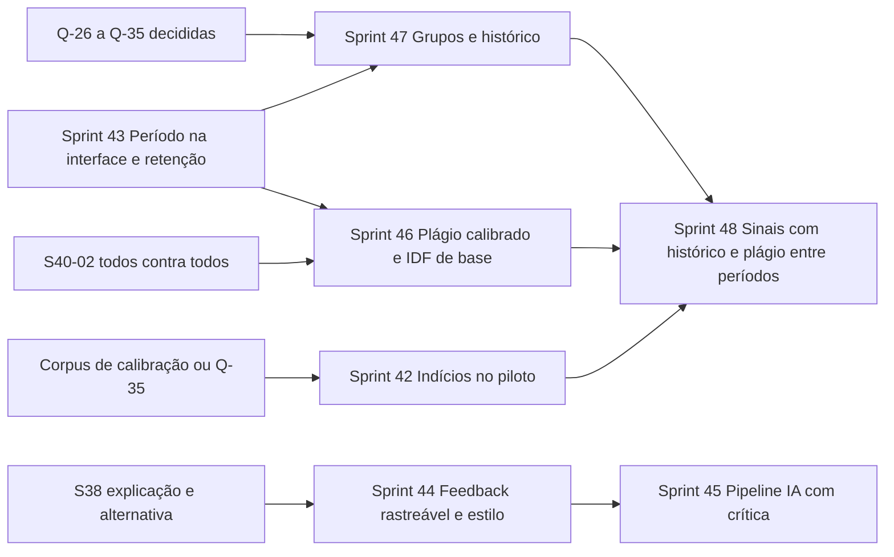

# IP-Checker — Revisão técnica e plano para seis frentes

**Data:** 12/10/2026. **Base analisada:** `ip-checker` em `develop` = `main` = `b313f7d` (local idêntico ao remoto); `ip-checker-gabaritos` em `main` = `2c7d9da` (local idêntico ao remoto). **Situação:** proposta. O plano entrou no blueprint (seção 7.16, Sprints 42 a 48), as perguntas em [`decisoes.md`](decisoes.md) (Q-26 a Q-35) e as ADR-12 a ADR-14 como propostas; nenhuma sprint começa sem o comando do autor. **Documento de permissões:** o `.docx` foi usado como fonte; o `.pdf` tem o mesmo conteúdo palavra a palavra (345 palavras, 0 diferenças; só a forma muda: quebras de linha, aspas tipográficas e a quebra de página antes de "Lista 5").

Tudo o que é afirmado aqui vem dos arquivos citados no formato `caminho:linha`. O que é inferência está marcado como **hipótese**. A análise foi só de leitura; nenhum código de gabarito foi lido ou reproduzido. Os nomes de alunos do exemplo são fictícios.

**Decisões do autor depois desta revisão (12/10/2026):** Q-26, Q-28 a Q-32 e Q-34 seguiram as recomendações, com duas mudanças: a Q-27 guarda só o resultado resumido de cada verificação, sem nada do código, o que rejeita a ADR-14 e tira do plano a antiga Sprint 48; e a Q-31 inclui o desenvolvedor entre os revisores. A Sprint 48 passou a ser a entrada com o Google no piloto. As soluções anteriores a 2023 e o formulário da pesquisa foram descartados. Q-33, Q-35 e Q-36 aguardam o autor. O estado atual está em [`decisoes.md`](decisoes.md) e na seção 7.16 do blueprint.

---

## 1. Resumo executivo

1. **O sistema é, por desenho, sem memória sobre alunos:** nenhum código, nome, histórico, turma ou feedback é guardado (NFR-11 em `docs/blueprint.md:213`; REC-07 em `docs/decisoes.md:58`). As frentes 5 e 6 (alunos por monitor, grupos com histórico compartilhado) exigem a **primeira persistência de dados pessoais de alunos** do projeto. Isso é uma decisão de política (LGPD, aviso de privacidade, retenção), não só de engenharia, e precede todo o resto.
2. **Período:** só um período é carregado por processo, a partir de `rulesets/ATIVO` (`engine/ruleset.py:618-631`); a API não expõe período em `/lists` nem aceita em `/validate`; **não existe seletor de período no frontend**, embora o blueprint diga que existe (FR-32 `:197`, US-37 `:308`). As listas são fixas (1 a 6) e o que varia por período são títulos, regras e questões: o painel "Período" deve vir **antes** de "Lista".
3. **Retenção de períodos é uma operação de Git, não do app:** apagar pastas não libera memória relevante (gabaritos têm teto de 5 MiB em memória, `gabaritos.py:36`) nem espaço no repositório (o histórico fica). O ganho real é de clareza na interface e no corpus de calibração. Recomendo **encerrar** (deixar de carregar) em vez de apagar, e nunca reescrever o histórico.
4. **Feedback:** o determinístico cita só "uso de for" (sem regra, sem linha, sem porquê: `engine/feedback.py:48-71`); as `message` do ruleset alimentam o relatório, não o feedback. O modo IA tem entrada estruturada, filtros e fallback (`feedback/compose.py:316-403`), mas não tem rastreabilidade por achado, nem checagem de "erro inventado" além de palavras-chave, nem ciclo de crítica. O "padrão do monitor" não existe: os textos são código Python (`compose.py:36-133`).
5. **Plágio:** a comparação é **léxica (tokens com winnowing) e estrutural (sequência de tipos de nó e multiconjunto de subárvores canonizadas)**, nunca textual nem semântica (`engine/similarity.py:164-178`; `similarity_tree.py`). O que falta: exclusão de código comum e do gabarito, comparação entre períodos (impossível sem guardar algo), limiares calibrados (os atuais são `[PREMISSA]`) e métricas de precisão e revocação registradas.
6. **Indícios de IA:** já são sinais com evidência e faixa, nunca veredito (`indicators.py:119-122`), e o sinal mais objetivo (construção de lista posterior ou fora do documento) já existe. Estão **desligados no piloto** (`render.yaml:36`) e a pasta `rulesets/2026.2/referencias` não existe, então o sinal de referência por IA é inerte em 2026.2. A pedido do autor, a ligação no piloto virou a Sprint 42.

**Recomendações de maior impacto, em ordem:** (1) decidir a política de dados de alunos (Q-26 a Q-28 abaixo) antes de qualquer tela de histórico; (2) período na interface com carregamento multi-período no analisador e retenção por "encerramento" com `--dry-run` (Sprint 43); (3) feedback determinístico rastreável por violação com um guia de estilo em YAML revisável por PR (Sprint 44, sobre a S38); (4) conjunto rotulado com plágio sintético e calibração dos limiares, com precisão e revocação na CI (Sprint 46); (5) grupos de acompanhamento como modelo único para as frentes 5 e 6, com o monitor solo como grupo de um (Sprint 47).

---

## 2. Mapa do sistema atual

### 2.1 Stack e estrutura relevante

| Camada | Tecnologia | Onde |
|---|---|---|
| API | FastAPI, asyncpg, Argon2id | `backend/src/ipc_api/` (rotas em `routes/`, contas em `accounts/`, auth em `auth/`) |
| Analisador isolado | FastAPI em processo separado, sem rede, carrega o ruleset uma vez no lifespan | `backend/src/ipc_analyzer/` (`service/app.py:436-439`) |
| Motor de regras | YAML declarativo + fatos da AST | `rulesets/<período>/base.yaml`, `engine/ruleset.py`, `engine/policy.py` |
| Plágio e indícios | `engine/similarity.py`, `engine/similarity_tree.py`, `engine/indicators.py` | idem |
| Feedback | `ipc_api/feedback/{compose,service,providers}.py` | provedores `openai_compat`, `gemini`, `fake` |
| Frontend | React 19 + Vite + Tailwind | `frontend/src/pages/{Checker,Plagiarism,Admin}.tsx`, componentes em `components/` |
| Banco | PostgreSQL (Supabase no piloto), migrações `0001` a `0006` | `database/migrations/` |
| Infra | Render (API + analisador), Vercel (SPA), UptimeRobot | `render.yaml`, `deploy/` |
| Gabaritos | Repositório privado separado, baixado para a memória da API na subida | `ipc_api/gabaritos.py:116-136` |

### 2.2 Fluxo de verificação

1. `GET /api/v1/lists` (`routes/meta.py:53-83`) devolve as listas 1–6 do manifesto do analisador, filtradas por `IPC_ENABLED_LISTS`, com as questões cadastradas e as que têm gabarito **do período ativo**. O período não é devolvido.
2. `POST /api/v1/validate` (`routes/validate.py:53-183`): corpo `code`, `list_number`, `question_id` opcional; sem campo de período (`questions.py:68` usa sempre `manifest.period`). A API chama o analisador, que devolve violações (`engine/models.py:21-33`: `rule_id`, `category`, `line`, `col`, `end_line`, `end_col`, `construct`, `allowed_from_list`, `message`), a comparação com o gabarito (`gabarito_result.py`) e, se `IPC_AI_INDICATORS=1`, os indícios.
3. Telemetria anônima (`telemetry.validation_event`, `0002_telemetria.up.sql:24-43`): período, lista, questão, versão do ruleset, resultado, contagens. Sem código, IP ou conta.
4. Feedback: `POST /api/v1/feedback` reanalisa o código (`routes/feedback.py:113`), monta o texto fixo e, com `enhance`, chama a cadeia de IAs.
5. Plágio: `POST /api/v1/similarity` (par) e `/similarity/batch` (uma contra a turma, até 100 soluções e 120 KB, `plagiarismClass.ts:7-9`).

### 2.3 Armazenamento e autenticação

- **Esquema `app`:** `account`, `account_email`, `session`, `email_token`, `management_log`, `feedback_quota`, `list_adoption` (`0001` a `0006`). **Não existem** tabelas de alunos, turmas, histórico de verificações ou feedbacks (`routes/similarity.py:4-5`; `docs/blueprint.md:1963-1965`).
- **Papéis:** `desenvolvedor`, `professor`, `monitor_chefe`, `monitor` (`accounts/models.py:17-23`); política pura em `auth/policy.py:6-47`; rotas protegidas por `require_active_account` (`auth/deps.py:37-46`) e `require_manager` no admin (`routes/admin.py:47-59`).
- **Sessão:** cookie `__Host-ipc_session`, token de 256 bits guardado só como SHA-256, 12 h ociosa e 7 dias absolutos (`auth/sessions.py:36-60`).
- **Limpeza:** tarefa diária automática (`housekeeping.py:24-35`) que chama `app.housekeeping()` (`0005_limpeza_e_cota.up.sql:30-68`); **não há** rota nem comando manual.
- **Gabaritos:** `dict[(período, questão) -> texto]` em memória, todos os períodos do repositório (`gabaritos.py:31-33`, `:86-113`); sem TTL nem recarga; só um novo processo recarrega.

### 2.4 Divergências entre local e remoto e entre documentos e código

| Item | Situação |
|---|---|
| `ip-checker` local × `origin/develop` e `origin/main` | 0 commits de diferença em cada sentido; só `develop` e `main` existem no remoto, mais as tags das releases |
| `ip-checker-gabaritos` local × `origin/main` | 0 commits de diferença |
| Blueprint diz "seletor de período" (FR-32 `:197`, US-37 `:308`) | **Não existe** no frontend (`grep` em `frontend/src` sem período fora de `Privacy.tsx`) |
| `rulesets/2027.1/questions/LEIA-ME.md:7-9` diz que L3-Q9, L4-Q4 e L4-Q5 "estão cadastradas" | A pasta não tem nenhum `.yaml` (texto copiado de 2026.2 pelo `new-period`) |
| `rulesets/README.md:16-17` descreve `referencias/` | Só existe em `2027.1`, vazia; em `2026.2` não existe |
| Repositório de gabaritos | Só `2026.2` (listas 1–4, 28 arquivos); sem `2027.1` e sem `excecoes.yaml` |
| Documento de permissões × catálogo | Os 54 itens do documento têm regra R-05 a R-68; 0 regras com `source` apontando para trecho inexistente. Interpretações registradas no catálogo sem base literal no documento: recursão liberada desde a L4 (R-59; o documento a lista só na L6), `zip()` livre desde a L5 (R-64, Q-04), `import` de biblioteca padrão proibido (R-05, Q-06), `global` como instrução (R-14, Q-03) |

---

## 3. Frentes

### Frente 1 — Período da turma

#### Estado atual, com evidências

- **Descoberta:** `rulesets/ATIVO` tem uma linha (`2026.2`); `active_period()` valida o formato `AAAA.P` e exige `<período>/base.yaml` (`engine/ruleset.py:597-631`); `load_ruleset()` carrega `base.yaml`, `questions/*.yaml` e `referencias/` **de um só período** (`:644-684`). O analisador carrega uma vez na subida (`service/app.py:436-439`); trocar de período = editar `ATIVO` e fazer deploy (ADR-10, decisão 3). "Inativo" não é um estado: é só "não é o do `ATIVO`".
- **Períodos existentes:** `rulesets/2026.2` (ruleset `2026.2.5`, 3 questões) e `rulesets/2027.1` (`2027.1.0`, 0 questões, cópia de 2026.2 por P-22). No repositório de gabaritos só `2026.2`.
- **Gabaritos:** indexados por `(período, questão)` para **todos** os períodos do repositório (`gabaritos.py:31-33`), mas a API só usa os do `manifest.period` (`routes/meta.py:77-82`, `questions.py:49-55`).
- **Listas:** fixas, exatamente `{1..6}` (`engine/ruleset.py:316-327`); títulos e regras vêm do `base.yaml:18-24` de cada período; a numeração das questões reinicia a cada período (P-07).
- **Frontend:** `ListSelector.tsx` e `QuestionSelector.tsx`; **nenhum** seletor de período.
- **Retenção:** nada apaga períodos. A limpeza diária cobre só sessões, tokens, contas e registros (`0005:30-68`); a telemetria expira em 12 meses (`0002:74-85`).

#### Problemas e riscos

1. A API aceita questões só do período ativo (P-07, `questions.py:49-55`): um monitor que corrige uma lista atrasada de 2026.2 em 2027.1 não consegue usar as regras certas.
2. O blueprint promete um seletor que não existe (FR-32, US-37).
3. Carregar vários períodos muda a premissa "um ruleset por processo" (`ruleset_version` nas respostas, hash único, telemetria com `semester` derivado de `ruleset_version` em `telemetry.py:90-92`).
4. "Apagar pastas para economizar memória" não se sustenta: um ruleset tem dezenas de KB; os gabaritos têm teto de 5 MiB (`gabaritos.py:36`); o Git guarda tudo no histórico. **Hipótese:** o custo real de muitos períodos é na interface (seletor comprido) e no tempo de subida da API (download de blobs um a um, `gabaritos.py:155-199`).
5. "Plágio entre semestres" não depende de pastas de período: depende de guardar algo das soluções dos alunos, que hoje não existe (frente 4 e 5).

#### Opções consideradas

| Opção | Como | Prós | Contras |
|---|---|---|---|
| A. Só o período ativo (como hoje), seletor informativo | Mostra o período no cabeçalho; nada muda na API | Nada a fazer no analisador | Não resolve a correção de lista atrasada; o blueprint continua errado |
| B. **Analisador carrega todos os períodos presentes em `rulesets/` (até o limite de retenção), com um "ativo"** | `load_rulesets(root) -> dict[período, Ruleset]`; manifesto lista os períodos; `/validate`, `/similarity` e `/feedback` aceitam `period` opcional (padrão = ativo) | Resolve a lista atrasada; gabaritos já estão indexados por período; poucos períodos (≤ 6) | Memória de N rulesets (pequena); `ruleset_version` passa a depender do período escolhido; telemetria e adoção já têm coluna `semester` |
| C. Um analisador por período | Vários processos | Isolamento total | Inviável no plano gratuito (0,1 CPU) |
| D. Período vindo do repositório de gabaritos | A API lista as pastas do repo de gabaritos | "Cadastrado" vira "tem gabarito" | Inverte a fonte da verdade: quem define regras é `rulesets/`; o repo de gabaritos pode ter um período sem regras (e vice-versa, como hoje) |

**Fonte da verdade (b):** para regras e questões, o repositório principal (`rulesets/`), pelo Git (ADR-10, decisão 1); para gabaritos, o repositório privado no GitHub (a API baixa de `origin/main`, `gabaritos.py:155-199`; a pasta local só vale no compose). A cópia local é uma área de trabalho: "sincronizar" é `git pull` e PR, como já descrevem `rulesets/README.md` e o README dos gabaritos. Não recomendo que o app leia pastas do disco do monitor.

**Posição do painel (c):** **Período antes de Lista.** Motivo no código: as questões (`questions/`) e os títulos e regras das listas (`base.yaml`) são por período; a lista só ganha sentido dentro de um período. Fluxo: Período (padrão: ativo) → Lista → Questão. Na tela, o período pode ficar como um seletor compacto antes de "Lista", com o rótulo "Período 2027.1 (ativo)".

**Regra de retenção (d):** o período corrente é o do `ATIVO` (configuração, não data). Recomendo manter: a data do sistema não sabe quando a UFPE abre o semestre (P-10) e uma troca automática em 01/01 ou 01/07 quebraria uma correção atrasada. A data serve só para um **aviso** em `/health/slo` e no painel Gerenciar: "o `ATIVO` é 2026.2 e já estamos em 2027" (**hipótese** de utilidade; barato de fazer). Contagem: **o ativo conta.** "6 períodos" = o ativo e os 5 anteriores (3 anos). Com o `ATIVO` em 2027.1, carregam-se 2027.1, 2026.2, 2026.1, 2025.2, 2025.1 e 2024.2; 2024.1 fica encerrado.

**Remoção segura (e):** não há tela de apagar. O fluxo é um comando com simulação e um PR:

```
ipc-rules retire-period 2024.1 --dry-run      # lista o que sairia e por quê; nunca o ativo
ipc-rules retire-period 2024.1                # move rulesets/2024.1 para rulesets/encerrados/2024.1
```

Quem executa: o monitor-mantenedor, por PR revisado por professor ou monitor-chefe (mesma alçada do `RULES.md` para `rulesets/**`). No repositório de gabaritos, o mesmo movimento por PR (`encerrados/2024.1/...`), que a API ignora ao indexar.

**Efeitos colaterais (f):**
- Git não esquece: mover para `encerrados/` não libera espaço; só uma reescrita de histórico liberaria, e ela quebra clones, tags e releases. Não recomendo.
- Memória do app: o ganho é o de não carregar um ruleset (dezenas de KB) e não baixar os gabaritos daquele período (poucos KB cada). Pequeno; o valor está na interface limpa e na subida mais rápida.
- Plágio entre semestres: nada de aluno sobrevive hoje. Gabaritos e referências de períodos encerrados servem de corpus de calibração (ADR-07 `:29`), então **encerrar e não apagar** preserva esse uso.

#### Recomendação

Opção B com retenção por encerramento: ADR-12 "Vários períodos carregados e retenção por encerramento", corrigindo a ADR-10 (decisão 3 passa a "trocar de período é mudar um arquivo; os cinco anteriores continuam disponíveis para consulta").

#### Mudanças concretas

- `engine/ruleset.py`: `load_rulesets(root) -> Rulesets` (mapa período → `Ruleset`, `active`, `retained: 6`), ignorando `encerrados/`; manifesto com `periods: [{period, active, ruleset_version, questions, gabaritos}]`.
- `service/app.py`: rotas internas recebem `period`; cache de preparação por `(período, hash)`.
- `ipc_api`: `GET /api/v1/periods` (ou o campo `periods` em `/lists`); `period` opcional em `ValidateRequest`, `SimilarityRequest`, `FeedbackRequest` (`schemas.py`), com 422 `UNKNOWN_PERIOD`; `questions.py` passa a resolver por `(period, question_id)`; `telemetry.py:90-92` usa o período da requisição.
- `cli.py`: `retire-period` com `--dry-run`; `new-period` passa a corrigir o `LEIA-ME.md` copiado (remover a lista de questões "cadastradas").
- Frontend: `PeriodSelector.tsx` antes de `ListSelector.tsx`; o rascunho (S37-05) guarda o período.
- Documentos: FR-32 e US-37 passam de "existe" para "entregue na Sprint 43"; `rulesets/README.md` ganha a seção "Encerrar um período"; ADR-10 revisada; ADR-12 nova.

#### Critérios de aceite e testes

1. Com `ATIVO=2027.1` e 7 pastas, o manifesto lista 6 e a sétima aparece só no `--dry-run` como "encerrável".
2. `POST /validate` sem `period` usa o ativo; com `period=2026.2` e `L3-Q9` usa as regras de 2026.2 (teste de contrato com os dois `ruleset_version`).
3. `retire-period` recusa o ativo e qualquer período dentro da janela; o `--dry-run` não toca no disco (teste com `tmp_path`).
4. Telemetria grava `semester` = período da requisição (teste em `test_telemetry*.py`).
5. e2e: escolher 2026.2 → Lista 3 → L3-Q9 e verificar; voltar ao ativo com "Próximo aluno".
6. Benchmark: a subida com 6 períodos não passa de +2 s em relação a 1 (medido no compose; limite `[PREMISSA]`).

**Esforço:** M (analisador e API: 2 dias; frontend e CLI: 1 dia; documentos: meio dia).

---

### Frente 2 — Qualidade do feedback

#### Estado atual, com evidências

**Modo determinístico ("Gerar feedback").** O motor reduz as violações a itens `(kind, label)`: `uso` com o nome legível da construção (`display.describe`, `engine/display.py:108-120`) e `falta` para R-02/R-68 (`engine/feedback.py:48-71`). A API monta: abertura por cargo e tratamento (`compose.py:36-52`, `:86-91`), frase obrigatória (`:54-55`, `:98-109`), anotação literal, uma dica de uso ou de falta e um fechamento escolhidos por hash (`:118-139`). Saída real, gerada localmente com um código próprio de 5 linhas na Lista 1 (um `for` com `range` e sem `if`):

```
Olá, Maria Souza, sou o monitor Fulano Monitor e seu código precisa de ajustes. Sua questão apresenta problemas, como o uso de for e range() e a falta de if ou operador ternário, portanto ela foi anulada. Como dica, reescreva o trecho com for e range() usando só o que já foi visto até esta lista. Lembre que a solução precisa usar if ou operador ternário, que é o assunto desta lista. Conte com a monitoria para o que precisar.
```

As violações do motor para o mesmo código tinham tudo o que o feedback não cita: `R-34 | FORA_DA_LISTA | L3:C1-L4:C15 | node:For | allowed_from_list=2 | "Laços de repetição (for, while) só são permitidos a partir da Lista 2."` e `R-35 | L3:C10-L3:C15 | builtin:range`. As `message` do ruleset vão para o relatório na tela (`report.ts:17-37`, `ResultPanel.tsx:88-110`), não para o feedback.

**Modo IA ("Aprimorar com IA").** Mesma rota com `enhance: true`. O serviço monta o rascunho determinístico e o prompt (`service.py:145-189`; `compose.py:243-311`): entram o resultado ("a questão tem problemas... (uso de for; falta de if ou operador ternário)"), a anotação, o código **sem comentários e docstrings, com e-mail/CPF/matrícula redigidos e o nome trocado por `[ALUNO]`** (`:170-199`), e o rascunho. **Não entram:** gabarito, enunciado, `question_id`, as `message` do ruleset, `R-xx`, linhas, o número da lista. O sistema (`SYSTEM_ENHANCE`, `compose.py:266-289`) pede até 6 frases, proíbe dizer se houve violação, citar problema não apontado, cumprimentar, formatar. Validação determinística (`free_text_problem`, `:316-403`): vazio, > 1.500 caracteres, > 10 frases, link/HTML/crase, saudação repetida, palavras de resultado (`anulad*`, `viola*`...), contradição por palavras, gênero fora do tratamento. Falha → próxima IA da cadeia com o **mesmo prompt**; nenhuma válida em 28 s → texto sem IA com `notice=NO_ANSWER` (`routes/feedback.py:40-43`, `:157-158`). Não há saída real de provedor registrada em testes ou documentos (só `FAKE_TEXT` e gravações fictícias).

**Padrão do monitor:** não existe guia, template, exemplos *few-shot* nem configuração de tom. Os textos estão em Python (`compose.py:36-133`, `:204-289`); o tom está numa frase do FR-30 (`docs/blueprint.md:187`) e na ADR-06 `:11`. O monitor pode editar o texto num `textarea` antes de copiar (`FeedbackPanel.tsx:229-235`).

**Planejado (S38):** campos `explicacao` e `alternativa` por regra no `base.yaml`, no cartão da violação (S38-01, `:1663`) e no feedback sem IA (S38-02, `:1664`); cache de 10 min do resultado por hash (S38-04).

#### Problemas e riscos

1. O feedback determinístico não cita linha, regra nem motivo; o aluno recebe "uso de for" e precisa adivinhar onde e por quê.
2. A ordem é "usos antes de faltas", perdendo a ordem de aparição que o motor dá (`compose.py:98-109`).
3. O validador da IA não sabe o que o motor achou: "nunca cite um problema que o verificador não apontou" é só uma instrução ao modelo, não um filtro. Uma IA que mencione `while` num código sem `while` passa.
4. Sem ciclo de crítica: a reserva recebe o mesmo prompt e tende ao mesmo erro (`test_service.py:183-192`).
5. "Não entregar a solução pronta" não é instrução nem filtro: o prompt pede "um trecho de código simples na própria frase" (`compose.py:276-277`).
6. Não há como um monitor-chefe ajustar o tom sem PR em Python.

#### Opções consideradas (padrão do monitor)

| Opção | Como | Prós | Contras |
|---|---|---|---|
| A. Guia de estilo só em `docs/` | `docs/estilo-do-feedback.md` | Zero código | O prompt e os templates continuam em Python; o guia envelhece |
| B. **Arquivo `feedback/estilo.yaml` versionado, carregado pela API** | Templates das dicas e fechamentos, regras de tom, 3 a 5 exemplos *few-shot* (com `[ALUNO]`) | Revisão por PR (monitor-chefe), testável, o prompt usa os exemplos | Um formato a mais a validar na CI |
| C. Estilo editável por conta, no banco | Campo em `app.account` | Cada monitor com a sua voz | Dados a mais, sem revisão; coerência da equipe se perde |

#### Recomendação

- Determinístico (c): cada item passa a ter **regra (nome, sem o `R-xx` para o aluno), linha(s), por quê (a `explicacao` da S38-01) e um caminho (a `alternativa`)**, na ordem de aparição. A frase obrigatória não muda (NFR-26). Alinhar à S38-02 e ampliá-la: o item vira `FeedbackItem(kind, label, rule_id, lines, explanation, alternative)`.
- Padrão do monitor (b): opção B, `backend/src/ipc_api/feedback/estilo.yaml` com `tom`, `dicas_uso`, `dicas_falta`, `fechamentos`, `exemplos` (entrada: itens e anotação; saída: continuação), validado por um esquema JSON na CI como o ruleset (S35-05).
- IA (d): pipeline em 5 etapas com **validador rastreável** e **uma rodada de crítica**, dentro dos 28 s já existentes.

#### Pipeline proposto para o modo IA

```
1. Entrada estruturada     FeedbackFacts = {resultado, itens[{regra, nome, linhas, explicacao, alternativa}],
                           anotacao, lista, vocabulario_permitido}   (só o que o motor achou; sem gabarito, sem enunciado)
2. Geração                 prompt = SYSTEM_ENHANCE + estilo.yaml(tom, exemplos) + fatos; o código entra como hoje
3. Validação               (a) filtros atuais (compose.py:316-403)
                           (b) rastreabilidade: toda construção citada (vocabulário de display.py) ∈ itens; caso contrário "achado inventado"
                           (c) "sem solução pronta": nenhum bloco com ≥ 3 linhas de código, nenhum trecho com os mesmos
                               ≥ 6 tokens consecutivos do gabarito  (comparação no servidor, o gabarito não sai)
                           (d) tom: lista de termos proibidos (ironia, imperativo seco) + ao menos 1 frase de encorajamento do estilo
                           (e) tamanho: ≤ 6 frases, ≤ 900 caracteres (hoje 10 e 1.500)
4. Crítica e reescrita     se (b)–(e) falhar e sobrar ≥ 10 s: 1 chamada "crítico" com a lista de problemas → reescrita; máx. 1 ciclo
5. Fallback                qualquer falha → texto determinístico (já existe), com notice=NO_ANSWER
```

A etapa 3(b) é possível sem IA porque os nomes legíveis são finitos (`display.py:5-105`): basta procurar no texto gerado as construções do vocabulário que **não** estão nos itens. A 3(c) compara tokens contra o gabarito na API (que já o tem em memória) sem enviá-lo ao provedor nem ao navegador (NFR-27).

#### Mudanças concretas

- `engine/feedback.py`: itens com `rule_id`, `lines`, `explanation`, `alternative` (lidos do ruleset, S38-01).
- `feedback/compose.py`: `template_text` por item, na ordem do motor; `estilo.yaml` carregado em `FeedbackStyle`; `enhanced_text_problem(text, facts)` com (b)–(e); `build_critique_prompt`.
- `feedback/service.py`: ciclo de crítica com orçamento; `source="llm"` continua; `notice=REWRITTEN` quando houve crítica (**hipótese** de utilidade para o monitor).
- `schemas.py`: `FeedbackResponse.items` (para a tela destacar o que foi citado).
- Esquema `backend/src/ipc_api/feedback/estilo.schema.json` e teste na CI.
- Documentos: FR-30 ganha "cada violação citada com linha e motivo"; NFR-26 ganha "0 construções citadas fora dos achados"; ADR-06 revisada (etapas 3b–4).

#### Casos de teste e rubrica

| Caso | Entrada | Esperado |
|---|---|---|
| T1 | Lista 1, `for` + `range`, sem `if` (o exemplo acima) | Cita `for` na linha 3 e `range()` na linha 3, a falta de `if`, a Lista 2 como liberação; 0 construções fora dos itens |
| T2 | Lista 3, código válido | Elogio e dica do estilo; 0 palavras de resultado; 0 contradição |
| T3 | Lista 2, `break` (R-11) com anotação "o laço está correto" | Anotação incorporada; cita só `break`; não diz "anulada" na parte livre |
| T4 | IA devolve texto citando `while` (ausente) | Recusado por 3(b); crítica reescreve ou cai no fallback |
| T5 | IA devolve 8 linhas de código | Recusado por 3(c) |
| T6 | IA devolve 6 tokens consecutivos do gabarito de L1-Q1 | Recusado por 3(c); o gabarito não aparece no log |
| T7 | Tratamento neutro | 0 marcas de gênero (lista existente) |
| T8 | 2 IAs com timeout | Fallback em ≤ 28 s com `NO_ANSWER` |

**Rubrica (0 a 2 por critério, meta ≥ 9/10 em 20 casos revisados pela equipe):** (1) todo achado citado com linha; (2) nenhuma afirmação sem achado; (3) o caminho de correção não é a solução; (4) tom cordial e encorajador (ao menos 1 frase); (5) tamanho e forma (≤ 6 frases, sem formatação).

**Esforço:** M para o determinístico e o estilo (2 dias, depois da S38); M para o pipeline da IA (2 dias).

---

### Frente 3 — Identificação de indícios de uso de IA

#### Estado atual, com evidências

- Política aprovada em 09/10/2026 (`docs/indicios-de-ia.md:3-5`, Q-21); ADR-08. Painel **desligado no piloto** (`IPC_AI_INDICATORS=0`, `render.yaml:36`; `settings.py:98`).
- Sinais em `engine/indicators.py`, faixas discretas e o conjunto recebe o `max` (`:142-144`):
  - `multiplas_violacoes` (`:152-245`): `variedade` (proibições gerais distintas: ≥ 2 médio, ≥ 3 alto), `repeticao` (mesma construção: ≥ 2 baixo, ≥ 3 alto), `salto_de_lista` (`allowed_from_list - list_number ≥ 2`: 1 médio, ≥ 2 alto), `fora_do_documento` (R-04: 1–2 baixo, ≥ 3 médio).
  - `referencia_ia` (`:253-311`): semelhança com `rulesets/<período>/referencias/<questão>/*.py` (80/90/95). **A pasta não existe em 2026.2**; inerte.
  - `gabarito` (`:314-337`): semelhança com o gabarito (80/90/95).
  - `estilo` (`:508-595`), sem faixa: docstring, anotações de tipo, `if __name__ == "__main__"`, nomes e comentários em inglês.
  - Perguntas para a conversa (`:636-680`). Aviso `NOTICE` (`:119-122`); nada é guardado nem logado (`docs/indicios-de-ia.md:16-18`).
- Histórico do aluno: não existe; REC-07 rejeitou estilometria contra o histórico por exigir guardar código ligado à pessoa (ADR-08 `:29`).
- Meta de calibração: ≤ 5% de soluções humanas (anteriores a 2023) na faixa alta (`docs/indicios-de-ia.md:68-82`); valores atuais `[PREMISSA]` (`indicators.py:95`).

#### Permissões por lista (extraídas do documento)

Regras gerais, com o trecho de origem: o enunciado prevalece ("a prioridade será sempre o que está definido na questão"); o assunto da lista é obrigatório; as permissões são cumulativas ("as permissões de cada lista são cumulativas"); "Tudo que não está presente nesse documento e nas questões é proibido!!"; 10 proibições gerais com anulação: "Bibliotecas externas; try/except; Sets; exit(); Classes; Args e Kwargs; break, continue; Pass; None; Variáveis globais."

| Lista | Permitido (novo nesta lista; citações do documento) | Proibido (além das 10 gerais) |
|---|---|---|
| 1 Condicionais | `if/elif/else`; variáveis; "is"; "Operações matemáticas e abreviações (+=, *=, etc)"; lógicos, relacionais e booleanos; ternário; concatenação; `print(), input()`; `abs()`; `int(), float(), str()`; `max(), min()`; `round()`; `len()`; `format()`; `capitalize(), upper(), lower(), isupper(), islower(), isnumeric()`; "in" para strings; f-strings; `\n` e `end=` no print; `type()` | Tudo das Listas 2–6 e qualquer item não listado |
| 2 Laços | `for, while`; `range()`; "in" para range; "zip(). (Somente para variar mais de um índice no comando for)" | `zip()` fora desse uso; Listas 3–6 |
| 3 Listas e tuplas | Listas; matrizes; tuplas; list comprehension; indexação e slicing; "in" para listas; `list(), tuple()`; `append, insert, pop, remove`; `del`; `sort, sorted, reverse, reversed`; `strip, replace, index, join, split, rsplit`; `sum, count, copy` | Listas 4–6; métodos não listados (ex.: `extend`, `find`) |
| 4 Funções | "Funções (def, parâmetros, return)"; "Retornar mais de um valor" | Listas 5–6; "Variáveis globais", "Args e Kwargs", "None" seguem proibidos |
| 5 Dicionários | Dicionários; `dict()`; `enumerate()`; `zip()` (sem a condição da L2); `keys, values, items`; `get, update`; "função lambda" | Lista 6; sets; `in` para dicionários não é citado |
| 6 Recursão | "Recursão. [Em todas as questões desta lista terá que ter recursão]" | Tudo o mais não listado |

Ambiguidades do documento que afetam a frente (pergunta aos professores, não decisão minha): recursão só na L6 (texto) × liberada desde a L4 (R-59); "Bibliotecas externas" × todo `import` (R-05, Q-06); "None" como literal ou como valor; "Args e Kwargs" na definição ou também em chamadas (R-10); `in` para tuplas e dicionários nunca citado; métodos homônimos (`pop`, `copy`, `index`, `count`, `update`) entre tipos.

#### Sinais propostos, por força e objetividade

| Sinal | Força | Objetividade | Base | Situação |
|---|---|---|---|---|
| Construção de lista posterior (`salto_de_lista`) | Alta se o salto ≥ 2 listas | Alta: ancorado no documento e no `since_list` | R-15…R-67 | Existe |
| Construção fora do documento (`fora_do_documento`, R-04) | Média | Alta | "Tudo que não está presente... é proibido" | Existe |
| Várias proibições gerais distintas (`variedade`) | Média–alta | Alta | R-05…R-14 | Existe |
| Semelhança ≥ 90% com referência gerada por IA (`referencia_ia`) | Alta | Média (depende da referência e da questão curta) | ADR-07 | Existe; sem referências em 2026.2 |
| Semelhança com o gabarito (`gabarito`) | Média | Média (ambígua: vazamento ou IA) | ADR-11 | Existe |
| Marcadores de estilo (docstring, tipos, `__main__`, inglês) | Baixa | Média | Nível da turma | Existe, sem faixa |
| **Novo:** tratamento de erro ou validação de entrada não pedida (ex.: `isdigit()` antes de `int()`, mensagens de erro genéricas em inglês) | Baixa | Média | Nível da turma (**hipótese**) | Propor como marcador de estilo |
| **Novo:** comentário por linha em registro formal ("Inicializa a variável contadora") | Baixa | Baixa | **hipótese** | Só como marcador, se a calibração mostrar ≤ 5% em humanos |
| Mudança brusca em relação ao histórico do aluno | Média | Baixa | Depende da frente 5 e da Q-27 | Não existe; REC-07 |

#### Falsos positivos e limitações

- Códigos de IP têm 5 a 40 linhas: qualquer detector estatístico (perplexidade, estilometria) tem pouco sinal, e os detectores comerciais de texto não valem para código curto (ADR-08 `:24-27`). A ferramenta já evita isso ao se apoiar em fatos do motor.
- O sinal mais forte (lista posterior) também pega um aluno que estudou adiante: por isso "indício", "conversa" e as perguntas.
- Referências por IA mudam com o modelo: uma referência de 2026 pode não parecer com o que a IA gera em 2027; o `referencias/` precisa de data e assistente no nome (`RULES.md:92-100` já pede).
- Marcadores de estilo em inglês penalizam quem programa em inglês por hábito: por isso ficam sem peso na faixa (`indicators.py:76-77`).

#### Saída (d)

Já é "indício + evidência (trecho e regra) + nível", nunca veredito (`IndicatorsPanel.tsx:73-128`). Proposta de ajuste: cada indício ganha `confianca: baixa|media|alta` e `evidencia: {regra, linhas, trecho ≤ 120 caracteres}`; a faixa do conjunto continua `max`. O registro de casos (confirmados e descartados) fica fora do sistema, por lista, sem nome, como a política já diz (`docs/indicios-de-ia.md:39-46`), até a Q-27.

#### Mudanças concretas

- `engine/indicators.py`: campo `evidence` por indício (regra, linhas, trecho); 2 marcadores novos de estilo atrás de calibração.
- Dados: criar `rulesets/2026.2/referencias/` (S33-05, externa) para o sinal 2 funcionar; `ipc-rules calibrate` sobre as soluções anteriores a 2023 quando chegarem (P-21).
- Documentos: `docs/indicios-de-ia.md` ganha a tabela acima; `docs/mapping-R-xx.md` ganha a coluna "ambiguidade do documento" com as 6 perguntas aos professores; ADR-08 ganha a nota sobre o sinal de histórico ficar bloqueado pela Q-27.

#### Critérios de aceite e testes

1. Toda saída de indício tem `evidencia` com regra e linhas (teste em `test_indicators.py`).
2. Nos 23 gabaritos de 2026.2 e nas referências, a faixa alta fica em 0% (como na medição de 11/10/2026, ADR-08 `:5`).
3. Nenhum texto do painel contém "veredito", "prova" afirmativa, "plagiou" ou "usou IA" (teste de vocabulário no frontend).

**Esforço:** P (código) + externo (referências e calibração).

---

### Frente 4 — Verificação de plágio

#### (a) Resposta direta

A verificação é **léxica e estrutural**, não textual nem semântica:
- **Léxica:** tokens do `tokenize` com comentários e espaços fora, strings viram `STR`, nomes do aluno viram `V0, V1...` por ordem de aparição e por comando; *winnowing* com k=5 e janela 4; Dice entre conjuntos (`engine/similarity.py:64-81`, `:293-355`).
- **Estrutural em sequência:** o mesmo *winnowing* sobre a sequência de tipos de nó da AST (`:86`, `:335-343`); peso 0,4 contra 0,6 da léxica (`:164-178`).
- **Estrutural por árvore canonizada (ADR-07):** reescritas (`+=`, `if not`, `>` → `<`, guardas, `for`/`while` → laço genérico), reordenação por dependência de dados dentro do bloco, multiconjunto de hashes de subárvores ≥ 3 nós com peso pelo tamanho, Dice e contenção, IDF da turma (`engine/similarity_tree.py:181-470`, `:573-664`, `:139-174`).
- A similaridade exibida é o **maior** entre a combinação léxica+sequência e a árvore (`similarity.py:176-178`). Não há grafo de fluxo de controle nem de dependência de programa (a alternativa D da ADR-07 ficou no backlog, `docs/blueprint.md:794`).

Faixas: 99 / 95 / 90 / 80 (`ipc_api/similarity.py:23-29`), classificadas como `[PREMISSA]` no NFR-25 (`docs/blueprint.md:227`). Código curto: aviso abaixo de 60 tokens (`:33`).

#### Estado atual do fluxo "turma"

Entrada por `textarea` com separador `### nome` (`Plagiarism.tsx:285-301`), até 100 soluções e 120 KB (`plagiarismClass.ts:7-9`), comparação **uma contra N** (`similarity.py:264-275`), prazo de 10 s no worker (`runtime/pool.py:60-61`). Tabela por rótulo com similaridade e faixa, "Comparar lado a lado" abre o par com trechos realçados (`Plagiarism.tsx:445-510`, `:398-442`). Defeitos conhecidos e já planejados: nomes repetidos (S36-01) e `###` dentro do código (S36-02). Todos contra todos: planejado na S40-02 (`docs/blueprint.md:1775`). Corpus rotulado: `backend/tests/similarity/pares.yaml` (25 pares com mínimo e máximo, inclusive `adr07_for_para_while`, `funcoes_reordenadas`, `variaveis_renomeadas`). `docs/eficacia.md` não mede o plágio.

#### (b) Plano de melhoria e avaliação das técnicas

| Técnica | Situação | Avaliação | Proposta |
|---|---|---|---|
| Normalização (comentários, espaços, renomear) | Feita nas duas métricas | Suficiente; cobre renomeação (≥ 99% no corpus) | Manter |
| Tokenização + winnowing (MOSS) | Feita (k=5, w=4) | Boa para cópia literal e parcial; cai em reescritas (ADR-07 `:7-20`) | Manter como segunda métrica |
| AST canonizada (Deckard) | Feita | Pega `for`→`while`, blocos reordenados, `if` invertido | Manter; medir |
| Exclusão de gabarito e trechos triviais | **Não existe** na comparação par a par; só o IDF do lote | Em questões curtas, a solução "natural" coincide com o gabarito e entre alunos (ameaça 20) | **IDF de base por questão**: corpus = gabarito + referências + soluções independentes de calibração; os hashes que aparecem em ≥ 50% do corpus pesam pouco. Não subtrair o gabarito (esconderia cópia do gabarito); mostrar "semelhança explicada pelo gabarito: x%" ao lado |
| Comparação entre turmas e períodos | **Não existe**; nada de aluno é guardado | Só possível guardando impressões digitais (multiconjunto de hashes + tamanhos), que não reconstroem o código | Depende da Q-27; ADR-14 |
| Limiares calibrados | `[PREMISSA]` | Sem precisão e revocação registradas | `ipc-rules calibrate-plagio` com o conjunto rotulado; limiares no `base.yaml`? Não: ficam na API (`BANDS`), mas documentados com a medição |
| Trechos lado a lado | Existe no par (até 30 trechos, `MAX_MATCHES`) | Falta na turma e no todos contra todos | Reusar `matches` por par da matriz, sob demanda |

#### (c) Custo par a par

- Preparação é linear por código e já é cacheada por hash no worker (ADR-11, decisão 2). Comparar dois multiconjuntos ordenados é O(|A|+|B|).
- n = 100 → 4.950 pares. Com o teto de 120 KB **para a turma inteira**, a soma dos tamanhos é limitada: **hipótese** de estimativa, 100 códigos de ~1,2 KB têm ~150 subárvores cada, então 4.950 × 300 operações ≈ 1,5 milhão, dentro de 1 s em 0,1 CPU. Dois códigos de 50 KB levam < 1 s (`test_similarity_tree.py:253-270`), mas esse caso não cabe duas vezes nos 120 KB.
- Para turmas maiores no futuro: índice invertido de fingerprints (winnowing) para filtrar pares candidatos que compartilham ≥ t fingerprints antes de calcular a árvore; só se o limite de 100 subir.
- Orçamento proposto para a S40-02: matriz de 100 em ≤ 5 s no worker (`class_timeout_s` passa de 10 s para 15 s na matriz), com progresso e cancelamento na tela (já previsto, `docs/blueprint.md:1803`).

#### (d) Avaliação com conjunto rotulado

Gerador de **plágio sintético** (`backend/tests/similarity/sintetico.py`), aplicado a: as soluções independentes do `pares.yaml`, as referências e, **só na CI local com `IPC_GABARITOS_DIR`**, os gabaritos (como o `official_answers` já faz; nada sai do processo):

| Transformação | Como |
|---|---|
| Renomear variáveis | `ast.NodeTransformer` sobre `Name`/`arg` do aluno |
| Reordenar blocos | permutar comandos do módulo e funções sem dependência |
| `for` → `while` | reescrever `for i in range(n)` e `for x in v` |
| Combinação | as três |
| Inserir linha inerte | `x = x` ou `print` extra |
| Independente (negativo) | pares de soluções distintas da mesma questão |

Métricas por faixa (90 e 95): **precisão** = positivos acima da faixa / tudo acima da faixa; **revocação** = cópias sintéticas acima da faixa / cópias. Metas propostas `[PREMISSA, a aprovar]`: revocação ≥ 95% na faixa 90 para as três transformações; precisão = 100% na faixa 95 e ≥ 90% na faixa 90 nos pares independentes do corpus. O relatório sai como `relatorio-plagio.json` no `ci-local`, e os números entram em `docs/eficacia.md` numa seção nova "Plágio".

#### Mudanças concretas

- `engine/similarity_tree.py`: `base_idf(corpus)` e combinação com `class_idf`; `explained_by(gabarito)`.
- `engine/similarity.py`: `compare_matrix(codes, budget)` (S40-02), reaproveitando `prepare`.
- `ipc_api/routes/similarity.py`: campo `gabarito_explica` na resposta do par; `class-matrix` com `pairs[]` e `groups[]` (componentes acima de 90).
- `cli.py`: `calibrate-plagio --corpus pares.yaml --sintetico --gabaritos <dir>`.
- Frontend: `Plagiarism.tsx` (depois da S39-01 dividir o arquivo): aba "Matriz" com grupos e "ver trechos" por par.
- Documentos: NFR-25 passa de `[PREMISSA]` a valores medidos; ADR-07 revisada (IDF de base, matriz, alternativa D reavaliada com a medição); `docs/eficacia.md` ganha a seção "Plágio".

#### Critérios de aceite e testes

1. `calibrate-plagio` imprime precisão e revocação por faixa e falha se cair abaixo das metas (gate na CI local).
2. Turma sintética de 30 (S40-02): os 2 grupos encontrados; 0 independentes ≥ 90.
3. Com `question_id` e gabarito, o par mostra "explicada pelo gabarito"; sem gabarito, o campo não aparece.
4. Matriz de 100 soluções de 1,2 KB em ≤ 5 s no compose.

**Esforço:** M (calibração e IDF de base: 2 dias) + M (matriz, já na S40-02) + G se a comparação entre períodos for aprovada (ADR-14).

---

### Frentes 5 e 6 — Alunos sob responsabilidade e grupos de monitores

#### Estado atual, com evidências

- Nenhuma tabela de aluno, turma, histórico ou feedback (`database/migrations/0001`–`0006`). O nome do aluno existe só no navegador, para o feedback (`FeedbackPanel.tsx:171-179`; `docs/blueprint.md:1965`), e nunca vai ao provedor (`compose.py:170-177`, NFR-24).
- NFR-11 ("O código não persiste em logs, banco ou disco", `:213`), NFR-12 (telemetria mínima, 12 meses), REC-07 (histórico do aluno fora do escopo) e a seção 9.2 "Dados pessoais (LGPD)" (`:1965`) desenham um sistema sem dados de alunos.
- Contas e papéis já existem (ADR-04), com `management_log` para auditoria de gerenciamento (`0003`), limpeza com prazos (`0005`) e adoção por `(conta, período, lista)` (`0006`).
- Período na base: só `semester` em `telemetry` e `list_adoption`.

#### Problemas e riscos

1. **Dado pessoal novo:** nome do aluno (e qualquer identificador) ligado a resultados de verificação, indícios e plágio. É dado pessoal de terceiro (o aluno não usa a ferramenta, P-13), tratado por uma universidade pública; a base legal provável é a execução de políticas públicas ou o legítimo interesse educacional (**hipótese jurídica; precisa da coordenação**). O aviso de privacidade (`Privacy.tsx`) e a seção 9.2 teriam de mudar.
2. **Código do aluno:** "painel exclusivo para analisar os códigos desses alunos" pode significar guardar o código. Isso revoga o NFR-11 e a REC-07. Alternativa: guardar **resultado, resumo e impressão digital**, nunca o texto; o código continua só no navegador (ou no Dikastis). Decisão Q-27.
3. **Retenção:** sem regra, o histórico vira um arquivo permanente de alunos. Coerente com a frente 1: apagar os registros do período quando ele é encerrado (6 períodos), ou antes, por decisão da coordenação.
4. **Concorrência:** dois monitores do mesmo grupo editando a lista de alunos ao mesmo tempo; o padrão atual do admin é "última escrita vence" com registro.
5. **Carga:** o plano gratuito tem `POOL_SIZE=5` e `MAX_PENDING=20` (`postgres.py:165-171`); um histórico gravado a cada verificação dobra as escritas por requisição (telemetria + registro). Precisa ser assíncrono e descartável como a telemetria (`telemetry.py:8-10`).

#### Opções de modelagem (frentes 5 e 6 juntas)

| Opção | Modelo | Prós | Contras |
|---|---|---|---|
| A. **Grupo de acompanhamento** (N monitores × M alunos, por período); monitor solo = grupo de 1 | `group`, `group_member`, `group_student`, `check_record(group_id)` | Um só conceito cobre solo, dupla e trio; histórico pertence ao grupo, então "compartilhar" é ser membro; composição muda sem mover registros; o aluno pode estar em vários grupos | Um grupo a mais para quem trabalha só (criado automaticamente: "Meu grupo") |
| B. Vínculos diretos monitor ↔ aluno, e "compartilhamento" por igualdade de conjuntos | `monitor_student`, `check_record(account_id, student_id)` | Mais simples no início | "Mesmo histórico" não tem dono: ao sair um monitor, os registros dele ficam ou somem? Dupla com um aluno a mais já não é "o mesmo conjunto" |
| C. Só no navegador (listas em `localStorage`, exportar e importar JSON) | Nenhuma tabela | Nenhum dado pessoal no servidor; LGPD intacta | Não compartilha entre monitores; perde ao trocar de máquina; sem auditoria |

#### Recomendação

Opção A, com o código **não** guardado (até a Q-27 dizer o contrário), registros assíncronos e expurgo por período. ADR-13 "Grupos de acompanhamento e dados de alunos".

#### Modelo de dados proposto (migração `0007_acompanhamento`)

```sql
CREATE TABLE app.student (                       -- mínimo: nome de exibição e um identificador opcional
  id uuid PRIMARY KEY DEFAULT gen_random_uuid(),
  semester text NOT NULL CHECK (semester ~ '^[0-9]{4}[.][12]$'),
  display_name text NOT NULL CHECK (length(display_name) BETWEEN 2 AND 120),
  external_ref text NULL,                        -- ex.: login do Dikastis; nunca CPF, e-mail ou matrícula (Q-26)
  created_by uuid NOT NULL REFERENCES app.account(id),
  created_at timestamptz NOT NULL DEFAULT now(),
  UNIQUE (semester, lower(display_name), coalesce(external_ref, '')));
CREATE TABLE app.follow_group (
  id uuid PRIMARY KEY DEFAULT gen_random_uuid(),
  semester text NOT NULL, name text NOT NULL CHECK (length(name) BETWEEN 2 AND 80),
  created_by uuid NOT NULL REFERENCES app.account(id), created_at timestamptz NOT NULL DEFAULT now(),
  archived_at timestamptz NULL);
CREATE TABLE app.group_member (                  -- convite e aceite
  group_id uuid REFERENCES app.follow_group(id) ON DELETE CASCADE,
  account_id uuid REFERENCES app.account(id),
  invited_by uuid NULL REFERENCES app.account(id), invited_at timestamptz NOT NULL DEFAULT now(),
  accepted_at timestamptz NULL, left_at timestamptz NULL,
  PRIMARY KEY (group_id, account_id));
CREATE TABLE app.group_student (
  group_id uuid REFERENCES app.follow_group(id) ON DELETE CASCADE,
  student_id uuid REFERENCES app.student(id) ON DELETE CASCADE,
  added_by uuid NOT NULL REFERENCES app.account(id), added_at timestamptz NOT NULL DEFAULT now(),
  removed_at timestamptz NULL,
  PRIMARY KEY (group_id, student_id));
CREATE TABLE app.check_record (                  -- um por verificação feita "para um aluno"; sem código
  id uuid PRIMARY KEY, created_at timestamptz NOT NULL DEFAULT now(),
  group_id uuid NOT NULL REFERENCES app.follow_group(id) ON DELETE CASCADE,
  student_id uuid NOT NULL REFERENCES app.student(id) ON DELETE CASCADE,
  performed_by uuid NULL REFERENCES app.account(id) ON DELETE SET NULL,   -- auditoria
  semester text NOT NULL, list_number smallint NOT NULL, question_id text NULL, ruleset_version text NOT NULL,
  outcome telemetry.outcome NOT NULL, violations jsonb NOT NULL,          -- [{rule_id, line, end_line}] sem trecho
  gabarito_percent numeric(4,1) NULL, indicator_level text NULL,
  similarity_alert boolean NOT NULL DEFAULT false,
  feedback_text text NULL,                                                 -- só se a Q-28 permitir
  code_sha256 bytea NOT NULL,                                               -- para "mesmo código reenviado"
  fingerprint bytea NULL);                                                  -- multiconjunto de hashes (ADR-14), só com a Q-27
CREATE TABLE app.group_log (                     -- quem convidou, aceitou, adicionou e removeu
  id bigint GENERATED ALWAYS AS IDENTITY PRIMARY KEY, at timestamptz NOT NULL,
  group_id uuid NOT NULL, actor_id uuid NULL, actor_name text NOT NULL, action text NOT NULL,
  target_kind text NOT NULL CHECK (target_kind IN ('monitor','aluno')), target_name text NOT NULL);
-- expurgo: app.purge_semester(semester) SECURITY DEFINER; chamado por retire-period e pela limpeza diária
--   para períodos fora da janela de 6; o ipc_app não tem DELETE direto
```

**Permissões (política em `auth/policy.py`):**

| Ação | Monitor (membro) | Monitor-chefe | Professor | Desenvolvedor |
|---|---|---|---|---|
| Criar grupo no período ativo | Sim | Sim | Sim | Sim |
| Convidar monitor; aceitar convite | Membro convida; o convidado aceita | Idem | Idem | Idem |
| Adicionar ou remover aluno | Membro | Membro, ou qualquer grupo do período | Idem | Idem |
| Ver histórico | Só dos grupos de que é membro | Todos os grupos do período (leitura) | Idem | Idem |
| Arquivar grupo | Criador ou último membro | Qualquer grupo | Idem | Idem |
| Expurgar período | Não | Não | Por PR (`retire-period`) | Idem |

**Concorrência:** registros são só inserção (append-only); membros e alunos têm `removed_at`/`left_at` em vez de `DELETE`; conflito de "adicionar o mesmo aluno duas vezes" resolvido pela chave primária (idempotente); a tela recarrega o grupo após cada ação e mostra "alterado por X há 2 min" (**hipótese** de UX).

**LGPD (minimização e retenção):** só `display_name` e `external_ref` opcional; sem e-mail, CPF ou matrícula (restrição no `CHECK`, como `account_email` já faz para domínios); nenhum código; registros do período expurgados ao encerrar o período (frente 1) ou após 12 meses do fim do período, o que vier primeiro (`[PREMISSA]` para a coordenação); exportação do próprio histórico pelo grupo em CSV; o aviso de privacidade passa a descrever o tratamento.

**Telas e fluxos:**
- "Meus alunos": grupos de que sou membro; criar; convidar (por nome ou e-mail de conta ativa); aceitar convite (sininho no cabeçalho); adicionar aluno (nome + referência opcional) com busca por nome no período.
- Na verificação: campo "Aluno" com busca nos meus grupos (opcional; sem aluno, nada é gravado); ao verificar, gerar feedback ou comparar, o registro é gravado em segundo plano.
- "Histórico do aluno": linha do tempo com lista, questão, resultado, regras, gabarito, indícios e quem fez; filtro por período; botão "reabrir no verificador" **sem** o código (o código não existe no servidor).
- Gerenciar: monitores-chefe e professores veem todos os grupos do período, só leitura.

**Endpoints:** `GET/POST /api/v1/groups`, `POST /groups/{id}/invites`, `POST /invites/{id}/accept`, `POST/DELETE /groups/{id}/students`, `GET /groups/{id}/history?student=`, `GET /students?q=`; `student_id` e `group_id` opcionais em `/validate`, `/feedback` e `/similarity` (gravação assíncrona, descartável sob carga).

#### Critérios de aceite e testes

1. Matriz cargo × ação × alvo testada por chamada direta (como o NFR-23 exige): monitor fora do grupo → 403 no histórico.
2. Um aluno em dois grupos aparece nos dois históricos com os mesmos registros (registro pertence ao grupo que o gravou; a tela do aluno une os grupos de que sou membro).
3. Registro não contém código: canário do NFR-11 estendido às tabelas novas.
4. `purge_semester('2024.1')` remove alunos, grupos e registros do período; migração com ida e volta (`test_migrations.py`).
5. Sob `StoreBusy`, a verificação responde normalmente e o registro é descartado e contado (como a telemetria).
6. e2e: criar grupo, convidar, aceitar, adicionar "Felipe Manoel" (fictício), verificar com o aluno escolhido, ver no histórico com "feito por".

**Esforço:** G (migração, política, 6 rotas, 3 telas, testes, aviso de privacidade: 5 a 6 dias), **bloqueado** pelas Q-26 a Q-28.

---

## 4. Roadmap em fases



| Fase | Sprints | O que entrega primeiro | Dependências |
|---|---|---|---|
| 0b. Indícios no piloto | 42 | O painel ligado, primeiro para a chefia e depois para todos | Corpus de calibração ou Q-35 |
| 0. Decisões | — | Respostas às perguntas da seção 5; aviso de privacidade revisado pela coordenação | Nenhuma; bloqueia a 3 |
| 1. Período | 43 | Seletor de período, correção de lista atrasada, `retire-period` | Depois da 36 (defeitos) e da 37 (tela) para não refazer a tela |
| 2. Feedback | 44, 45 | Feedback que cita linha e motivo (valor imediato para a campanha de testes); depois a IA com crítica | S38-01/02 |
| 3. Plágio | 46 | Precisão e revocação medidas; IDF de base; matriz com grupos | S40-02; a 43 para corpus por período |
| 4. Acompanhamento | 47 | Grupos, alunos e histórico | Fase 0; a 43 (período nas tabelas) |
| 5. Sinais com histórico | 48 | Indício "mudança brusca", plágio entre períodos por impressão digital | 46, 47 e Q-27 |

A ordem sugerida em relação ao plano vigente: 36 → 37 → 38 → 42 → 43 → 44 → 39 → 40 → 46 → 45 → 47 → 48, com a 41 (Fase 2) onde a P-09 e a Q-12 permitirem. A 43 antes da 39 evita refatorar `Plagiarism.tsx` e `Checker.tsx` duas vezes (**hipótese** de economia).

---

## 5. Perguntas em aberto (decisões suas ou da coordenação)

| ID | Pergunta | Afeta | Padrão até a resposta |
|---|---|---|---|
| Q-26 | Que identificador de aluno pode ser guardado: só nome de exibição, login do Dikastis, matrícula? (Recomendo nome + login do Dikastis opcional; nunca CPF ou e-mail.) | Frentes 5 e 6 | Só nome |
| Q-27 | Pode-se guardar **alguma coisa do código** ligada ao aluno? (a) nada; (b) impressão digital (hashes de subárvores, não reversível); (c) o código. A (b) habilita plágio entre períodos e o sinal de histórico; a (c) revoga o NFR-11. | Frentes 3, 4, 5 | (a) |
| Q-28 | O texto do feedback enviado ao aluno pode ficar no histórico? | Frente 5 | Não |
| Q-29 | Retenção dos dados de alunos: ao encerrar o período (6 períodos) ou 12 meses após o fim do período? A coordenação precisa aprovar o aviso de privacidade. | Frentes 1 e 5 | 12 meses |
| Q-30 | O aluno deve ver o nome da regra ("Laços de repetição") ou o `R-xx` no feedback? | Frente 2 | Nome, sem ID |
| Q-31 | Quem revisa `estilo.yaml` e os exemplos *few-shot*: monitor-chefe ou professor? (Mesma dúvida da S38-01.) | Frente 2 | Monitor-chefe |
| Q-32 | Metas de precisão e revocação do plágio (proposta: revocação ≥ 95% na faixa 90; precisão 100% na 95). | Frente 4 | Proposta |
| Q-33 | Aos professores: recursão na L4/L5, `None` como literal ou valor, `in` para tuplas e dicionários, `pop`/`copy` de dicionário na L5, e se uma questão pode liberar uma proibição geral. | Frente 3 e catálogo | Catálogo atual |
| Q-34 | O "ativo" conta na janela de 6 períodos? (Recomendo que sim.) | Frente 1 | Sim |
| Q-35 | Se as soluções anteriores a 2023 não chegarem, como calibrar os indícios antes de ligar no piloto? (a) esperar; (b) outra fonte de soluções humanas com data anterior a 2023; (c) ligar só para a chefia por uma lista e usar o registro de casos como calibração. A (b) e a (c) mudam a política e precisam da coordenação. | Frente 3, Sprint 42 | (a) |

---

## 6. Proposta de atualização dos documentos: sprints, histórias, requisitos, ADRs e DoD

Em 12/10/2026, esta seção virou texto do blueprint (seção 7.16, requisitos, histórias, ADRs e DoD), do README, do `docs/README.md` e de `decisoes.md`, e as ADR-12 a ADR-14 foram criadas como propostas. IDs de regra (R-xx) não são criados; os IDs novos são de histórias, requisitos, tasks, decisões e ADRs, seguindo a numeração atual (US até 38, FR até 32, NFR até 28, ADR até 11, Q até 25, S até 41).

### 6.1 Roadmap (blueprint 7.1)

- Novo item: **"Fase 1g — Acompanhamento e sinais (Sprints 42 a 48), proposta de 12/10/2026:** indícios de IA ligados no piloto (42, a pedido do autor), período na interface e retenção (43), feedback rastreável e padrão do monitor (44), pipeline de IA com crítica (45), plágio calibrado (46), grupos de acompanhamento e histórico (47), sinais com histórico e plágio entre períodos (48). Bloqueios: Q-26 a Q-29 antes da 47; Q-27 antes da 48."
- Linhas novas na tabela de sprints (mesmo formato das 36–41, "sob comando do autor").
- Backlog: "comparação entre períodos" e "sinal de histórico" saem de "fora do escopo" (REC-07) para "bloqueados pela Q-27".

### 6.2 Requisitos novos e corrigidos

| ID | Texto proposto | Frente |
|---|---|---|
| FR-32 (correção) | "...o seletor de período **entra na Sprint 43**; até lá, só o período ativo" | 1 |
| FR-33 | Vários períodos carregados (o ativo e até 5 anteriores), escolhidos pela interface e aceitos pela API em `period`; períodos encerrados ficam em `rulesets/encerrados/` e não são carregados | 1 |
| FR-34 | Cada violação citada no feedback traz o nome da regra, a linha e o motivo (explicação e alternativa do ruleset) | 2 |
| FR-35 | Guia de estilo do feedback versionado (`estilo.yaml`) com tom, dicas e exemplos, revisado por PR | 2 |
| FR-36 | Grupos de acompanhamento por período, com convite e aceite entre monitores, alunos sem exclusividade e histórico por aluno | 5, 6 |
| FR-37 | Precisão e revocação do plágio medidas sobre um conjunto rotulado com plágio sintético, a cada release | 4 |
| NFR-11 (nota) | Mantido: nenhum código em banco, logs ou disco, **inclusive nas tabelas de acompanhamento** (canário estendido) | 5 |
| NFR-26 (acréscimo) | 0 construções citadas pela IA fora dos achados do motor; 0 trechos ≥ 6 tokens iguais ao gabarito | 2 |
| NFR-29 | Dados de alunos: só nome de exibição e referência opcional; expurgo por período; aviso de privacidade atualizado | 5, 6 |
| NFR-30 | O todos contra todos de 100 soluções (120 KB) termina em ≤ 5 s no worker | 4 |

### 6.3 Histórias novas (Épicos E1, E3, E7 e um Épico E8 — Acompanhamento)

| ID | Persona | Ação | Valor | Critério de aceite (resumo) |
|---|---|---|---|---|
| US-39 | Monitor | escolher o período antes da lista | corrigir uma lista atrasada com as regras do período certo | Dado `ATIVO=2027.1`, Quando escolho 2026.2 e L3-Q9, Então a resposta traz `ruleset_version` 2026.2.x |
| US-40 | Monitor-mantenedor | encerrar um período com simulação | manter só 6 períodos carregados sem perder nada do Git | `--dry-run` não altera o disco; o ativo nunca é encerrado |
| US-41 | Membro da equipe | ver no feedback a linha e o motivo de cada violação | o aluno sabe onde e por quê | Cada item com linha e explicação; frase obrigatória inalterada |
| US-42 | Monitor-chefe | ajustar o tom e os exemplos do feedback por PR | padronizar a equipe sem programar | `estilo.yaml` inválido falha na CI; a mudança aparece no próximo feedback |
| US-43 | Membro da equipe | receber um texto da IA que só fala do que o verificador achou | nunca mandar ao aluno um erro inventado | Texto com construção fora dos achados é recusado e reescrito ou substituído |
| US-44 | Membro da equipe | ver a matriz da turma com grupos e trechos | achar os grupos de cópias de uma vez | Turma sintética de 30: 2 grupos; trechos por par |
| US-45 | Monitor | criar meu grupo, convidar colegas e cadastrar meus alunos | acompanhar os mesmos alunos em dupla ou trio | Convite aceito dá acesso ao histórico; sair do grupo não apaga registros |
| US-46 | Monitor | ver o histórico de um aluno meu com quem fez cada verificação | acompanhar a evolução e dividir o trabalho | Linha do tempo por período, lista e questão, sem código |
| US-47 | Monitor-chefe ou professor | ver todos os grupos do período, só leitura | supervisionar sem editar | 403 ao tentar editar; registro de leitura não é exigido |

### 6.4 Tasks por sprint (formato da seção 7.15)

A versão completa, no formato das outras sprints, está na seção 7.16 do blueprint.

**Sprint 42 — Indícios de IA ligados no piloto** (incluída a pedido do autor em 12/10/2026). Reúne o que faltava da Sprint 33 (S33-02, S33-03, S33-05 e S33-06), acrescenta a evidência e a confiança em cada indício e uma ligação gradual por cargo (`IPC_AI_INDICATORS` igual a `0`, `chefia` ou `1`). Bloqueio: o corpus de calibração ou a Q-35.

**Sprint 43 — Período na interface e retenção por encerramento.** Objetivo: corrigir uma lista atrasada com as regras do período certo e manter só 6 períodos carregados. Personas: monitor (US-39) e mantenedor (US-40).

| ID | História | Descrição técnica | Componente | SP | Dep. | Conclusão |
|---|---|---|---|---|---|---|
| S43-01 | US-39 | `load_rulesets` multi-período no analisador; manifesto com `periods`; cache por `(período, hash)` | `engine/ruleset.py`, `service/app.py` | 2 | — | Testes de carga de 6 períodos; hash por período |
| S43-02 | US-39 | `period` opcional em validate, similarity e feedback; `GET /periods`; telemetria com o período da requisição | `ipc_api/schemas.py`, `routes/*`, `telemetry.py` | 1 | S43-01 | Contrato OpenAPI; 422 `UNKNOWN_PERIOD` |
| S43-03 | US-39 | `PeriodSelector` antes de `ListSelector`; rascunho guarda o período; plágio idem | `frontend/src/components`, `Checker.tsx`, `Plagiarism.tsx` | 1 | S43-02 | e2e lista atrasada |
| S43-04 | US-40 | `ipc-rules retire-period --dry-run`; `encerrados/` ignorado pelo carregador e pelo índice de gabaritos; aviso de `ATIVO` defasado em `/health/slo` | `cli.py`, `gabaritos.py`, `routes/meta.py` | 1 | S43-01 | Recusa o ativo e a janela; teste com `tmp_path` |
| S43-05 | US-40 | Documentos: ADR-12, ADR-10 revisada, `rulesets/README.md` "Encerrar um período", FR-32 corrigido, `LEIA-ME.md` de 2027.1 corrigido, `new-period` sem copiar a lista de questões | docs, `cli.py` | 1 | — | Revisão |

Deploy: release `sprint-43`; Render (analisador e API) e Vercel; sem migração. Riscos: `ruleset_version` por período muda os painéis que agrupam por versão (verificar `v_top_rules_by_list`).

**Sprint 44 — Feedback rastreável e padrão do monitor.** Objetivo: cada violação citada com linha e motivo; o tom definido num arquivo revisável. Personas: monitor (US-41) e monitor-chefe (US-42). Depende da S38-01/02.

| ID | História | Descrição técnica | SP | Conclusão |
|---|---|---|---|---|
| S44-01 | US-41 | `FeedbackItem` com `rule_id`, `lines`, `explanation`, `alternative`; ordem do motor; `template_text` por item | 2 | T1–T3 da rubrica; NFR-26 intacto |
| S44-02 | US-42 | `estilo.yaml` + esquema + carregamento; prompts passam a usar `tom` e `exemplos` | 1 | CI valida; mudança reflete sem código |
| S44-03 | US-41 | `FeedbackResponse.items`; tela destaca no editor a linha citada ao passar o mouse | 1 | Vitest |
| S44-04 | — | `docs/estilo-do-feedback.md` (como editar), FR-34, FR-35, ADR-06 revisada | 1 | Revisão |

**Sprint 45 — Pipeline de IA com validação rastreável e crítica.** Objetivo: nenhum erro inventado chega ao aluno. Persona: membro da equipe (US-43).

| ID | Descrição técnica | SP | Conclusão |
|---|---|---|---|
| S45-01 | Validador 3(b) (vocabulário de `display.py` × itens), 3(c) (bloco de código; tokens do gabarito na API), 3(d) tom, 3(e) tamanho | 2 | T4–T6; 0 gabarito em logs (canário) |
| S45-02 | Ciclo de crítica (1 rodada) dentro dos 28 s; `notice` quando houve reescrita | 1 | T8; `test_service.py` |
| S45-03 | 20 casos revisados pela equipe com a rubrica; resultado em `docs/eficacia.md` | 1 | Média ≥ 9/10 |

**Sprint 46 — Plágio calibrado.** Objetivo: limiares medidos e código comum descontado. Persona: membro da equipe (US-44). Depende da S40-02.

| ID | Descrição técnica | SP | Conclusão |
|---|---|---|---|
| S46-01 | Gerador de plágio sintético e `calibrate-plagio` com precisão e revocação por faixa; gate na CI local | 2 | Metas da Q-32 |
| S46-02 | IDF de base por questão (gabarito + referências + corpus) e "explicada pelo gabarito" | 2 | Pares curtos independentes caem abaixo de 80 |
| S46-03 | Matriz com grupos e trechos por par; orçamento NFR-30 | 1 | 100 soluções ≤ 5 s |
| S46-04 | NFR-25 com valores medidos; ADR-07 revisada; `docs/eficacia.md` "Plágio" | 1 | Revisão |

**Sprint 47 — Grupos de acompanhamento e histórico.** Bloqueada pelas Q-26 a Q-29. Personas: monitor (US-45, US-46), monitor-chefe e professor (US-47).

| ID | Descrição técnica | SP | Conclusão |
|---|---|---|---|
| S47-01 | Migração `0007` (tabelas da seção 3, frentes 5 e 6), `purge_semester`, papéis SQL; ida e volta | 2 | `test_migrations.py` |
| S47-02 | Política cargo × ação × alvo em `auth/policy.py`; rotas de grupos, convites, alunos e histórico | 2 | Matriz testada por chamada direta |
| S47-03 | Gravação assíncrona e descartável do `check_record` em validate, feedback e similarity | 1 | Sob `StoreBusy` a resposta não muda |
| S47-04 | Telas "Meus alunos", campo "Aluno" na verificação, "Histórico do aluno", leitura no Gerenciar | 3 | e2e do critério 6 |
| S47-05 | Aviso de privacidade, seção 9.2, NFR-29, ADR-13, runbook (expurgo) | 1 | Aprovação da coordenação |

Deploy: migração **antes** da release e nunca junto com `render.yaml` (P-18).

**Sprint 48 — Sinais com histórico e plágio entre períodos.** Bloqueada pela Q-27 (b). ADR-14 "Impressões digitais persistentes": guardar o multiconjunto de hashes de subárvores (não reversível) por registro; comparar a submissão com os registros do mesmo `question_id` em períodos anteriores; indício "mudança brusca" por distância entre marcadores de estilo do mesmo aluno. Tasks S48-01 a S48-04 a detalhar depois da decisão.

### 6.5 ADRs

| ADR | Título | Decisão central | Alternativas a registrar |
|---|---|---|---|
| ADR-10 (revisão) | Questões e gabaritos por período | Decisão 3 passa a "o ativo e os 5 anteriores são carregados; encerrados em `encerrados/`" | — |
| ADR-12 | Vários períodos carregados e retenção por encerramento | Opção B da frente 1; o `ATIVO` continua a fonte; encerramento por CLI e PR; nunca reescrever histórico | A, C, D da tabela |
| ADR-06 (revisão) | Feedback por LLM com moldura determinística | Entrada estruturada com itens rastreáveis; validador por vocabulário; 1 ciclo de crítica; `estilo.yaml` | Guia só em docs; estilo por conta |
| ADR-07 (revisão) | Plágio por árvore canonizada | IDF de base por questão; matriz com grupos; alternativa D reavaliada com números | Subtrair o gabarito (rejeitada: esconde cópia do gabarito) |
| ADR-13 | Grupos de acompanhamento e dados de alunos | Opção A; sem código; expurgo por período; política de acesso | B e C da tabela |
| ADR-14 | Impressões digitais persistentes para plágio entre períodos | Só se Q-27 = (b) | Guardar código (c); não guardar nada (a) |

### 6.6 Definition of Done (acréscimos à seção 8)

- [ ] Nenhum dado de aluno fora das tabelas da ADR-13; o canário do NFR-11 cobre as tabelas novas.
- [ ] Toda rota nova de grupos tem a matriz cargo × ação × alvo testada por chamada direta.
- [ ] `calibrate-plagio` não regrediu em precisão nem revocação (quando a S45 entrar).
- [ ] `estilo.yaml` e os rulesets de todos os períodos carregados passam no `ipc-rules validate`.
- [ ] Uma migração que cria tabelas com dados pessoais vem com a função de expurgo e o teste dela.

### 6.7 README e `docs/README.md`

- README: parágrafo de abertura cita a Fase 1g e as perguntas Q-26 a Q-35; tabela de sprints com as linhas 42–48 ("Proposta"); "Decisões recentes" com a proposta de 12/10/2026.
- `docs/README.md`: entradas para `estilo-do-feedback.md` (S44-04) e a seção "Plágio" de `eficacia.md`.
- `docs/decisoes.md`: Q-26 a Q-35 como `[QUESTÃO]` abertas; REC-07 anotada como "reaberta pela Q-27".
- `rulesets/README.md`: "Encerrar um período" e o aviso sobre o `LEIA-ME.md` copiado.
- README dos gabaritos: pasta `encerrados/` e a regra de que a API a ignora.
- Correções pontuais já identificadas: FR-32 e US-37 (seletor inexistente); `rulesets/2027.1/questions/LEIA-ME.md:7-9`; docstring de `backend/tests/benchmark/engine_benchmark.py` com a meta antiga do NFR-02 (já prevista na S36-07).

---
